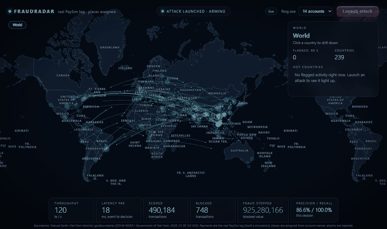
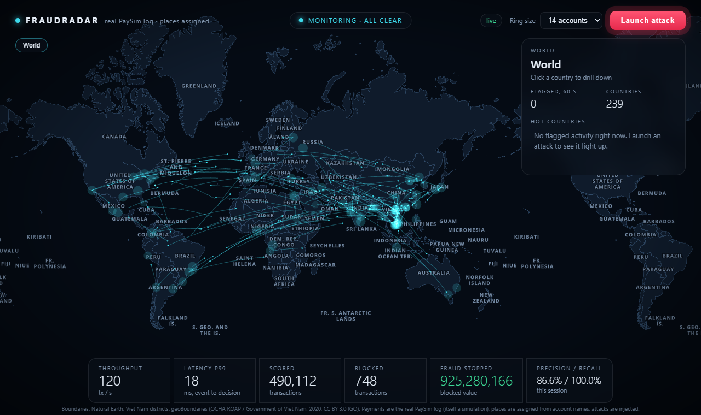
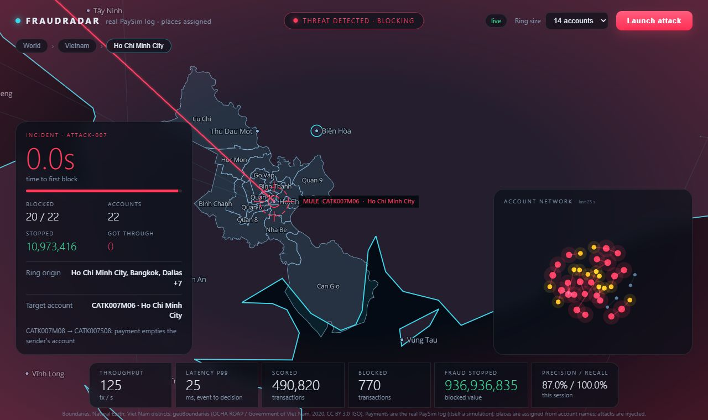
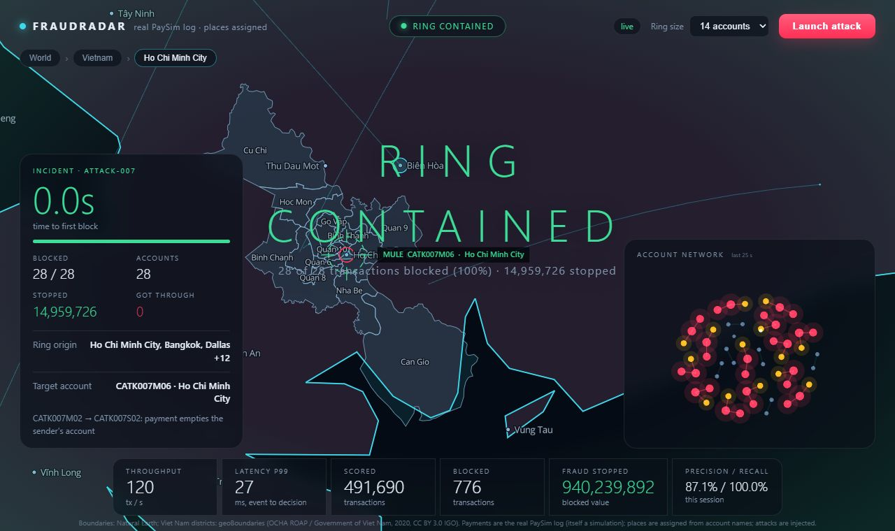

# FraudRadar

[](https://github.com/nguyenhoangkhang-2010/fraudradar-realtime-fraud-detection/actions/workflows/ci.yml)
[](LICENSE)

A real-time fraud detection system, built end to end: payments stream through Kafka, are scored one at a time with
point-in-time streaming features and a LightGBM model, and show up on a live map you can drill into from the world
down to a city's districts. A button injects a fraud ring so you can watch the system find it.



*The real PaySim log streaming through the system while an injected attack is blocked. PaySim has no locations, so
places are assigned from account names; the map is decoration, the scores are not.*

## What this demonstrates

- **A streaming ML system, not a notebook.** Redpanda (Kafka) feeds a scorer that builds features from the state
  *before* each payment, scores with LightGBM, and publishes decisions; a FastAPI gateway pushes them over
  WebSocket to the map. About 7 ms from event to decision at 120 tx/s on a laptop (one observation, not a load test).
- **Evaluation that checks itself.** The same model is measured on a simulation and on real data, and the two
  results are reported side by side, with the weaknesses written next to them.

  | | PaySim (simulated payments, real log) | IEEE-CIS (real card payments) |
  |---|---|---|
  | Test payments / fraud | 1,248,736 / 4,250 | 118,108 / 4,064 |
  | Average precision | 0.9995 | 0.51 |
  | ROC AUC | about 1.0 | 0.90 |
  | Fraud caught at the validation-chosen threshold | 99.98% at 0.039% false alarms | 44% at 1.3% false alarms |

  The gap is the point: PaySim's fraud follows a rule the simulator wrote. Details in
  [Model results on PaySim](#model-results-on-paysim) and [Real card payments: IEEE-CIS](#real-card-payments-ieee-cis).
- **Training and serving agree.** The serving code, fed one payment at a time, reproduces the notebook's test metrics
  to the digits shown ([replay](#replaying-the-real-paysim-log)), and the live Kafka pipeline gave the same number of
  false blocks as the offline replay on the same rows.
- **Bugs found by testing against reality**, each fixed and written up: a simulator whose honest traffic looked
  nothing like the training data ([skew check](#training-serving-skew-check)), a model file LightGBM could not read
  after Git rewrote its line endings, and a Docker image missing a system library.

## Architecture

```mermaid
flowchart LR
  sim["simulator<br/>synthetic traffic or the PaySim log,<br/>plus injected attacks"]
  tx[("transactions")]
  sc["scorer<br/>point-in-time features<br/>LightGBM or heuristic"]
  dec[("decisions")]
  api["api<br/>FastAPI + WebSocket<br/>rolling metrics"]
  ui["browser<br/>MapLibre map + account graph"]
  ctl[("control")]
  sim --> tx --> sc --> dec --> api --> ui
  ui -- "Launch attack" --> api
  api --> ctl --> sim
```



## Screenshots

| | |
|---|---|
|  |  |
| Traffic arcs on the world map, nothing flagged. | The camera follows the money to the mule account, down to the district. |
|  | |
| 28 of 28 payments of the injected ring blocked. | |

> **Status:** works end to end (streaming path, features, model serving, tests, UI, CI). Feature state lives in the
> scorer's memory, so there is one scorer replica for now; see [Roadmap](#roadmap) for what is deliberately not done.

## Run it

Requires Docker.

```bash
docker compose up --build
```

Open <http://localhost:8000> and press **Launch attack**. (To run the map on the real PaySim log instead of the
simulator, see [Demo on the real PaySim log](#demo-on-the-real-paysim-log).) To score with the LightGBM model trained on PaySim
instead of the heuristic, see [Serving the PaySim model](#serving-the-paysim-model):

```bash
SCORER=lightgbm docker compose up --build
```

The page is a flat world map you can drill into: **world, then country, then city, then district**.

- Click a country to zoom in. Its borders, capital and cities appear and the other countries dim.
- Click a city to zoom to it. Viet Nam's five big cities (Hanoi, Ho Chi Minh City, Da Nang, Haiphong,
  Can Tho) open into their districts.
- Click a district to zoom to it. The breadcrumb at the top, the side panel's list, and `Esc` all go back up.
- Hover anything for its name and its flagged-payment count over the last 60 s.

When a ring is detected the camera follows the money down to the mule account (country, then city, then
district), shock waves mark each blocked payment, and an account network and an incident card show what was
caught. Regions with flagged traffic turn amber to red. If you start exploring yourself during an incident,
the camera stays where you put it.

The map, the network graph and the fonts' glyphs come from a CDN or this repo as noted below, so the page
needs internet access for MapLibre and d3. `/globe.html` is an earlier 3D-globe version of the same stream.

Offline checks need no Docker or Kafka:

```bash
pip install -e ".[dev,model]"
pytest
python -m fraudradar.evaluate
python -m fraudradar.evaluate --scorer lightgbm
python -m fraudradar.skew
```

## Training a model

Training is separate from running the services and needs none of Docker, Kafka or a GPU. Install the
training libraries (LightGBM, scikit-learn, SHAP, pandas, Polars, DuckDB, JupyterLab) in one go:

```bash
conda env create -f environment.yml
```

or, with plain pip in a virtual environment:

```bash
pip install -r requirements-train.txt
```

Then, in the activated environment, make `fraudradar.features` importable from notebooks without pulling in the
service dependencies:

```bash
pip install -e . --no-deps
```

Keep downloaded datasets in `training/data/` and trained models in `models/`; both are git-ignored. Link to
the dataset in this README rather than committing it.

## How it works

```
simulator ──► [transactions] ──► scorer ──► [decisions] ──► api ──WebSocket──► browser
    ▲                                                          │
    └──────────────────────[control]◄──────── POST /api/attack ┘
```

| Service | Job |
|---|---|
| `simulator` | Publishes legitimate traffic at a steady rate. Emits a fraud ring when it receives an `attack` command. |
| `scorer` | Computes features, scores, decides `allow`, `review` or `block`, publishes the decision. |
| `api` | Reads decisions, keeps rolling metrics, streams them to the browser. |
| `redpanda` | Kafka-compatible broker, single node. |

### Features (`src/fraudradar/features.py`)

Computed per transaction from the state *before* it, then the state is updated.
A transaction never sees itself, and `tests/test_features.py` checks that.

| Feature | Meaning |
|---|---|
| `new_account` | Sender is younger than 7 days |
| `amount_z` | Amount against the sender's own history (log scale) |
| `velocity` | Sender's transactions in the last 60 s |
| `shared_device` | Other accounts seen on the same device |
| `young_fan_in` | Distinct young accounts paying the same recipient in 60 s |
| `flagged_linked` | Recently blocked accounts among device mates, co-senders and the sender |

The last three are the graph-style signals that make a ring visible when each
single payment looks plausible.

### The data

All traffic is synthetic, from `src/fraudradar/generator.py`. Honest traffic is
made deliberately awkward: popular merchants receiving many payments, new but
honest accounts, family members sharing a device, rare large purchases. A fraud
ring is 3 to 60 young accounts on a few shared devices paying one mule.

Ground truth travels with each transaction as `truth` so the system can be
measured. The scorer never reads it, and a test asserts that.

### Geography

Accounts live in 96 "active places": the 80 largest places in the world plus Viet Nam's larger cities,
weighted by the square root of population, with Viet Nam boosted 4x (about a quarter of the traffic) so
the district view has something to show. In Hanoi, Ho Chi Minh City, Da Nang, Haiphong and Can Tho an
account also has a district. **All locations are simulated.** None of this is real customer data.

The map data lives in `src/fraudradar/data/` and is built by `python scripts/build_geodata.py`, which
downloads the sources, simplifies the shapes and checks the district counts.

| Data | Source | Licence |
|---|---|---|
| Countries, populated places, capitals | [Natural Earth](https://www.naturalearthdata.com/) 50m / 10m | Public domain |
| Viet Nam districts | [geoBoundaries](https://www.geoboundaries.org/) gbOpen ADM2 (OCHA ROAP / Government of Viet Nam) | CC BY 3.0 IGO |
| Label font | Open Sans glyphs from [OpenMapTiles fonts](https://github.com/openmaptiles/fonts) | Apache 2.0 |
| Map renderer | [MapLibre GL JS](https://maplibre.org/) 5.15.0 | BSD-3-Clause |

Limits worth knowing:

- **District data is the 2020 structure.** Viet Nam merged provinces and removed the district level in
  2025, so these are the boundaries as they stood before that. District names have no diacritics, as in the
  source.
- **District detail exists for five cities only.** The province layer in geoBoundaries does not line up
  with its district layer at several borders (Hanoi's province polygon swallows districts of Hung Yen, Ha
  Nam and Bac Ninh), so districts cannot be assigned to all 63 provinces automatically. Ho Chi Minh City and
  Da Nang are assigned spatially and match their known counts (24 and 8); Hanoi (30), Haiphong (15) and
  Can Tho (9) are listed by name. The build script prints each count and flags any mismatch.
- District shapes are simplified (about 30 m) and country shapes more (about 1 km), so borders are good
  for display, not for surveying. Antarctica is left out.
- Natural Earth shows disputed borders as it does; no claim is made about them.

## Results so far

Measured by `python -m fraudradar.evaluate` (seed 7, 120 s at 150 tx/s, two
rings of 14 accounts), heuristic scorer:

| Metric | Value |
|---|---|
| Honest transactions blocked | 1 of 18,000 |
| Ring transactions blocked | 61 of 80 (76%) |
| Ring accounts blocked at least once | 27 of 28 |
| Time to first block after a ring starts | 2.6 s and 0.7 s for the two rings |

The same replay with `--scorer lightgbm` is in [Serving the PaySim model](#serving-the-paysim-model).

These come from synthetic data produced by the same project, so they show the
pipeline works. They do **not** show how it would do on real fraud.

In the live demo on a laptop (one broker, one scorer, 120 tx/s) the UI showed
end-to-end latency of about 7 ms p50 and 10 to 17 ms p99, event time to
decision. That is an observation, not a load test.

## Model results on PaySim

A LightGBM model trained with `training/paysim_lightgbm.ipynb` on the
[PaySim](https://www.kaggle.com/datasets/ealaxi/paysim1) dataset (6,362,620 payments over 743 hours). The split is
by time: train on hours 1-281, choose the alert threshold on hours 282-355, report on the untouched hours 356-743.
Everything below is the **test** part; the raw numbers are in [docs/results/paysim_v1](docs/results/paysim_v1).

| Model | Average precision | Fraud caught | Alerts that are fraud | Honest payments flagged |
|---|---|---|---|---|
| Logistic regression | 0.638 | 63.2% | 66.2% | 0.110% |
| LightGBM, payment features only (A) | 0.9995 | 99.98% | 71.0% | 0.139% |
| LightGBM, A + history (A+B) | 0.9985 | 99.7% | 88.2% | 0.046% |
| **LightGBM, all features (A+B+C)** | **0.9995** | **99.98%** | **89.7%** | **0.039%** |

"Fraud caught", "alerts that are fraud" and "honest payments flagged" are measured with the threshold set on the
validation part so that about 0.1% of honest payments are flagged. The last column shows what that threshold
actually did on the test part, which is why the rows are not comparable on precision alone. One prediction takes
about 1.8 ms (p99 6 ms) on a Kaggle CPU notebook, one process; that is not a load test.

How to read this honestly:

- **PaySim is easy.** The two strongest signals are "this payment empties the sender's account" and the ratio of the
  amount to the balance. That is the rule the PaySim simulator uses to create fraud, so a model that sees only the
  payment is already near-perfect. The score shows the pipeline and the split are sound; it says little about
  real-world fraud.
- **The history and chain features added nothing measurable.** The chain features never fire on PaySim (their SHAP
  value is zero), and the AP differences between A, A+B and A+B+C are about 0.001. That is from one seed and one
  split, so treat it as noise, not as evidence that any group helps or hurts.
- **Precision is not comparable across rows.** Each row's threshold flagged a different share of honest payments
  on the test part (last column).
- The PaySim fraud rate (about 0.13%) is a property of the simulation.

## Serving the PaySim model

`SCORER=lightgbm` makes the scorer service (and `python -m fraudradar.evaluate --scorer lightgbm`) use the model
from the section above. The model is a 0.47 MB text file in `src/fraudradar/artifacts/paysim_v1/`, next to the
metadata the notebook wrote. `pip install -e ".[model]"` adds LightGBM; the heuristic needs nothing extra.

What changed to make that possible:

- A transaction can now carry `kind`, the sender's and recipient's balance before the payment, and a merchant
  flag, as a mobile-money feed does. The simulator keeps account balances up to date. A fraud-ring account holds
  exactly what it will send, so its last payment empties it; the mule pools what arrives.
- `payment_features.py` rebuilds the model's 14 inputs from the stream, with the same point-in-time rule as the
  heuristic's store. It refuses a model whose feature list it cannot build.
- The alert thresholds are not 0.85 and 0.5. They come from the model's metadata (score at 0.1% and at 0.01% of
  honest payments flagged on validation), about 0.004 and 0.006, because the model's scores follow the base rate.
  `BLOCK_THRESHOLD` and `REVIEW_THRESHOLD` override them.

The same replay (seed 7, 120 s at 150 tx/s, two rings of 14 accounts):

| Metric | Heuristic | LightGBM |
|---|---|---|
| Honest transactions blocked | 1 of 18,000 | 33 of 18,000 (0.18%) |
| Ring transactions blocked | 61 of 80 (76%) | 44 of 80 (55%) |
| Ring accounts blocked at least once | 27 of 28 | 28 of 28 |
| Ring money stopped | 80% | 54% |

Read it as a check that serving works, not as a verdict on the model:

- **The simulator was bent towards the model, and that makes the comparison circular.** A ring now ends each
  account with a sweep, which is what PaySim fraud looks like and what the model learned. The model catches every
  sweep and misses most of the smaller payments before it, which is why it stops less money than the heuristic.
- **Honest traffic does not look like PaySim's.** The [skew check](#training-serving-skew-check) measured it:
  PaySim's honest payments empty the sender's account 31% of the time and the simulator's do 0.1%, and the
  simulator has no zero-balance senders (PaySim: 33%). So the 33 honest blocks above say how the model treats
  *this simulator's* honest traffic, not how it would treat PaySim's. 20 of the 33 are honest sweeps, which the
  model treats as theft; the other 13 depend on the amount scale (in a similar replay, 150 / 1,500 / 5,000 gave
  0.10% / 0.20% / 1.4% honest blocks).
- **Live on Kafka** (Docker Compose, `SCORER=lightgbm`, one laptop, 120 tx/s): the UI showed about 7 ms p50 and
  22 ms p99 from event time to decision, and a ring of 14 accounts had 38 of its 45 payments blocked, the first
  within the same tick. One observation, not a load test. The Docker image needs the `libgomp1` system package for
  LightGBM; the slim Python image lacks it and the scorer crashed on start until the Dockerfile installed it.
- One prediction runs in the scorer's event loop, one process; throughput under load is not measured.

## Demo on the real PaySim log

The map can run on the rows of the real PaySim file instead of the simulator. With the CSV in `training/data/` (see
above), and the same Docker setup:

```bash
docker compose -f docker-compose.yml -f docker-compose.paysim.yml up -d --build
```

The simulator publishes the file's rows at 120 per second, starting at the first hour after the model's validation
part (hour 356), so every payment shown is one the model never trained or tuned on; at the end of the file it loops.
The scorer uses the LightGBM model, reads the same file to rebuild the history of every earlier row before it scores
the first one it receives, and resynchronises the same way after a restart. Expect about a minute and a half before
the first decision: about 20 s to locate the start row and 50 s to read 5.1 million earlier rows, through Docker's
file sharing on Windows. The scorer then holds about 1 GB of feature state. The header of the page says
"real PaySim log" so it cannot be mistaken for the simulator.

What is real and what is not:

- **Real:** type, amount, both balances, merchant flag, hour counter and fraud label of every row.
- **Made up for the map:** where an account is. PaySim has no places, so each account name is hashed to one of the
  map's places, weighted like the simulator's (about a quarter land in Viet Nam). The same account is always in the
  same place, but the place means nothing; the arcs and the districts are decoration.
- **Injected:** the **Launch attack** button adds PaySim-style fraud (14 victim accounts, each swept into a fresh
  account that then cashes out, labelled `attack-NNN`). It is the pattern the model learned, so the model catches all
  of it (28 of 28 payments blocked in the runs I did). That shows the pipeline reacting, not detection skill.
- **Fraud shown in the file** is labelled by the hour it falls in (`paysim-hNNN`), so the incident card and the
  precision and recall figures count real PaySim fraud together with injected attacks. For real-data numbers use the
  replay above. Amounts have no currency sign because PaySim's currency is unspecified.

Observed on a laptop with Docker (one broker, one scorer, one process): 120 tx/s sustained, about 7 ms p50 and
9 to 14 ms p99 from publish to decision once the scorer had caught up. That is one observation, not a load test.

**Live matches offline.** After the demo had streamed about 464,000 rows it showed 99 false blocks; the offline
replay over the first 460,000 to 475,000 rows of the same file gives 99 as well. So the Kafka pipeline, the cold-start
sync and the feature store add nothing and lose nothing compared with the replay. That stretch of the file has a
higher false-block rate (0.021%) than the test part as a whole (0.0052%), because the rate varies over the log;
that is the data, not a fault of the pipeline.

## Training-serving skew check

A model scores whatever features it is given, so if the stream feeds it values spread differently from the ones
it learned from, its scores mean something else. `python -m fraudradar.skew` replays the simulator through the
same `PaymentFeatureStore` the scorer uses and compares every feature with `reference_stats.json`, which the
notebook writes from the training part of PaySim (section 4b). It reports the population stability index (PSI)
per feature, below 0.1 close, 0.1 to 0.25 moved, above 0.25 a different distribution; honest traffic is compared
with all PaySim payments and the fraud ring with PaySim's fraud. It also prints the amount scale that would line
up the median amount, and how often the model splits on each feature (a feature with 0 splits cannot matter, so
its skew is harmless). It changes nothing by itself. The ring is a few dozen payments, so its figures are noisy.
The reference is `reference_stats.json`, made by the notebook from the real PaySim training part (3,820,599
payments, 3,193 of them fraud) and committed next to the model.

**First measurement** (`python -m fraudradar.skew`, seed 7, 120 s at 150 tx/s, honest traffic against all PaySim
payments). 8 of the 11 features that differ are ones the model uses; the other 3 are never split on.

| Feature | PaySim | Simulator | PSI |
|---|---|---|---|
| Payment is a `TRANSFER` | 8% | 40% | 2.5 (all types) |
| Payment is a `CASH_OUT` / `CASH_IN` | 36% / 22% | 13% / 0% | |
| Payment empties the sender's account | 31% | 0.1% | 1.8 |
| Sender's balance was zero | 33% | 0% | 2.8 |
| Amount is at least 100x the sender's balance | 37% | 0% | 5.4 (ratio) |
| Hour of day | night lull, 39% of fraud before 10:00 | even | 0.8 |
| Amount (median, log scale) | 11.2 | 11.1 | 0.77 |
| Recipient's earlier payments received | median 2 | median 5 | 0.7 |

What it says:

- **The simulator's money model is far from PaySim's.** In PaySim many senders have no money or send more than they
  hold, and a third of honest payments empty the account. In the simulator senders always have enough and almost
  never empty it. The model can only tell a sweep from a theft by combining several of these signals, and the
  simulator never produces the combinations it learned from.
- **`AMOUNT_SCALE` holds up.** Scanning it from 500 to 8,000, the amount distance is smallest between 1,500 and
  1,760, and the medians match to within 0.2 on the log scale. The remaining distance is the shape of the amount
  distribution, not its level. The scale that aligns the medians is 1,760; the default stays at 1,500.
- **The ring differs from PaySim fraud too.** It pools money into one mule, so the recipient has a long history
  (median 19 earlier payments), while PaySim fraud mostly goes to fresh accounts (median 0). Its amounts are far
  larger (median 15.4 against 12.9 on the log scale). Some ring payments are blocked partly because of that.
- Not fixed here. Making the simulator's honest traffic match these figures means calibrating it to PaySim, which is
  a design change of its own and would make the comparison with the model more circular, not less.

## Replaying the real PaySim log

The simulator's honest traffic does not look like PaySim's (see above), so numbers measured on it say little about the
model. `python -m fraudradar.replay` feeds the model the rows of the real PaySim file instead, in file order, through
the same `PaymentFeatureStore` and the same bundled model the scorer uses, and scores them against the fraud labels.
It needs the dataset CSV (not in the repo; download it from [Kaggle](https://www.kaggle.com/datasets/ealaxi/paysim1)
and put it in `training/data/`, which is git-ignored), and takes about a minute and a half:

```bash
python -m fraudradar.replay --part test
```

The history features count every earlier payment, so the whole file is walked in order and only the chosen part is
scored. The CSV used here has the same SHA-256 as the one the model was trained on (`16910f90...eea6b`).

Test part (hours 356-743, never used for training or for choosing thresholds; 1,248,736 payments, 4,250 fraud),
at the two thresholds the notebook chose on validation:

| | Replay through the serving code | Notebook |
|---|---|---|
| Average precision | 0.99952 | 0.99952 |
| Flagged above the review threshold (0.1% of honest payments on validation): fraud caught | 4,249 of 4,250 (99.976%) | 99.976% |
| ... alerts that are fraud | 89.698% (488 false alarms) | 89.698% |
| ... honest payments flagged | 0.039% | 0.039% |
| Flagged above the block threshold (0.01%): fraud caught | 4,249 of 4,250 | 99.976% |
| ... alerts that are fraud | 98.493% (65 false alarms) | 98.493% |
| ... honest payments flagged | 0.0052% | 0.0052% |

Raw output: [docs/results/paysim_replay](docs/results/paysim_replay). What this does and does not show:

- **Training and serving agree.** Features rebuilt one payment at a time by the serving code reproduce the
  notebook's vectorised features closely enough that every metric above matches to the digits shown. That is the
  check the skew section could not make on simulated traffic. A test also checks that scoring in chunks gives the
  same numbers as the service's one-at-a-time path.
- **It is still PaySim.** These are the numbers from the PaySim section again, now through the serving path. PaySim is
  a simulation whose fraud is mostly "empty the account"; this says nothing about real-world fraud. The one missed
  fraud in 4,250 is not a sign of a perfect model.
- **Only the test part is a fair score.** The notebook used the validation part for early stopping and for the
  thresholds, and the model trained on the train part. The replay prints those too (validation AP 1.0000,
  train AP 0.9962); do not quote them as performance.
- **Speed.** Walking and scoring all 6.36 million rows in chunks took 94 s on a laptop (about 68,000 rows/s, one
  process). Scoring the first 30,000 rows one at a time through `ScoringEngine.handle`, as the service does, ran at
  about 25,000 rows/s with a median of 0.04 ms and a p99 of 0.10 ms per payment. Those are early rows with almost no
  fraud, so few of them paid for the explanation step; it is not a load test and leaves out Kafka.

## Real card payments: IEEE-CIS

PaySim is a simulation, so its near-perfect score says little about real fraud. To see what the same method gets on
payments where nobody wrote the fraud rule, `training/ieee_cis_lightgbm.ipynb` trains and tests a LightGBM model on the
[IEEE-CIS Fraud Detection](https://www.kaggle.com/competitions/ieee-fraud-detection) data: 590,540 real, anonymised
online card payments from Vesta, 3.5% fraud, over 182 days. It uses only the two labelled training files and makes its
own split by time: train on days 0-100, choose the early-stopping point and thresholds on days 100-140, and report on
days 140-182 (118,108 payments, 4,064 fraud), which the model never saw. The data is not in the repo; the notebook's
`metadata.json` has the SHA-256 of both files. Raw results: [docs/results/ieee_cis_v1](docs/results/ieee_cis_v1).

| Model (test part) | Average precision | ROC AUC | Fraud caught at about 5% false alarms | Alerts that are fraud | Fraud caught at about 1% false alarms | Alerts that are fraud |
|---|---|---|---|---|---|---|
| Random guessing | 0.034 | 0.5 | | | | |
| Logistic regression | 0.165 | 0.796 | 50.7% | 18.4% | 31.6% | 28.5% |
| LightGBM, payment columns (A) | 0.516 | 0.895 | 63.1% | 29.1% | 45.3% | 56.9% |
| LightGBM, A + proxy-account history (B) | 0.508 | 0.900 | 63.4% | 29.5% | 44.1% | 55.4% |

Next to PaySim, where the same method scores AP 0.9995, the real data gives AP about 0.51 and ROC AUC about 0.90. At a
budget of about 1 honest payment in 100 flagged, the model catches under half of the fraud and about 4 in 10 alerts are
wrong. That gap is the point: it measures how much of PaySim's score came from the simulator's rule.

How to read it:

- **The history features did not help.** AP is 0.009 lower and ROC AUC 0.005 higher with them: one split and one seed,
  so no difference. There is also a warning sign. `email_prior_n`, a running count of earlier payments per email
  domain, is the model's third most important feature by gain (3.3%). A running count only ever grows, so it may be
  acting as a clock rather than as behaviour, and for common domains its test-period values are, by construction,
  larger than any seen in training. A count over a recent window would be the fair version; it has not been run.
- **The "accounts" are a guess.** The data has no account number, so payments sharing `card1, card2, card3, card5` and
  `addr1` are treated as one account (42,946 of them). That is an assumption, not a fact.
- **The validation figure is optimistic.** The model was stopped (762 rounds) and the thresholds were chosen on the
  validation part, where its AP is 0.63. The test AP of 0.51 is the honest number. The thresholds set for 5% and 1% false
  alarms gave 5.4% and 1.3% on the test part, a mild shift.
- **No decay showed up within 70 days.** Scored on four successive slices of the test period, ROC AUC stays between
  0.890 and 0.904. AP rises from 0.45 to 0.56, but AP depends on the fraud rate (2.9% to 4.1% across slices) and each
  slice has only about 1,000 fraud cases, so read it as noisy, not as improvement.
- **The linear baseline did not converge** in 200 iterations, so its row is a loose lower bound.
- **Many inputs cannot be explained.** The anonymised `V` columns hold 37% of the gain, and the two most important
  features are `V258` and `V257`.
- **This is not a leaderboard number.** The competition scored a different, later, unlabelled period, and its top
  entries used far more feature engineering.

## Roadmap

- [x] Train a LightGBM model on PaySim and report it honestly (see above)
- [x] Serve that model in the scorer in place of `HeuristicScorer` (opt in with `SCORER=lightgbm`)
- [ ] Move feature state to Redis so several scorer replicas can run; use more than one partition
- [x] Replay the real PaySim log through the serving code and compare with the notebook (see above)
- [x] Benchmark on real card payments (IEEE-CIS), see above
- [x] Demo on the real PaySim log (`docker-compose.paysim.yml`)
- [ ] IEEE-CIS follow-up: windowed history counts instead of running counts, and several seeds/splits
- [ ] Calibrate the simulator against a public dataset (for example IEEE-CIS or PaySim); the skew check lists what is off
- [ ] Load test, with p50/p99 under rising throughput
- [ ] Drift detection and automatic retraining when attackers change tactics
- [x] Training-serving skew check, with a first measurement against the real PaySim training part (see above)
- [ ] Feature lineage

## Layout

```
scripts/
  build_geodata.py  downloads and builds the map datasets
src/fraudradar/
  geo.py         active places and districts, shared by the simulator and the map
  data/          countries, places and districts as GeoJSON (built, committed)
  generator.py   synthetic traffic and fraud rings
  features.py    streaming features for the heuristic, point-in-time correct
  payment_features.py  the PaySim model's 14 inputs, built from the stream
  model.py       heuristic scorer and thresholds
  lgbm.py        loads the trained LightGBM model and explains its scores
  artifacts/     the trained model, its metadata and (once added) reference_stats.json
  skew.py        training-serving skew check
  replay.py      replays the real PaySim log through the serving code
  paysim_stream.py  the PaySim log as the demo's live traffic
  serving.py     builds the engine for a scorer name
  engine.py      features -> score -> action
  evaluate.py    offline replay and metrics
  simulator/     Kafka producer + control listener
  scorer/        Kafka consumer/producer around the engine
  api/           FastAPI, WebSocket hub, metrics, static UI (map, fonts)
tests/
```

## Licence

The code is released under the [MIT licence](LICENSE). The map data and the label font keep their own
licences, listed under [Geography](#geography); the sources must be credited as described there.
