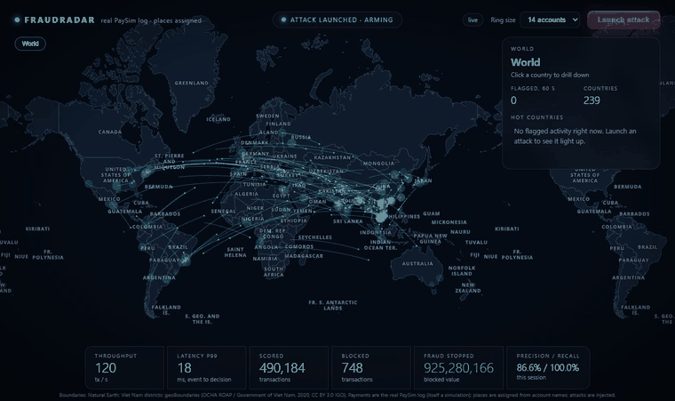
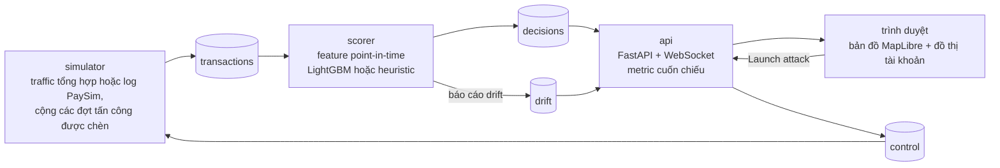
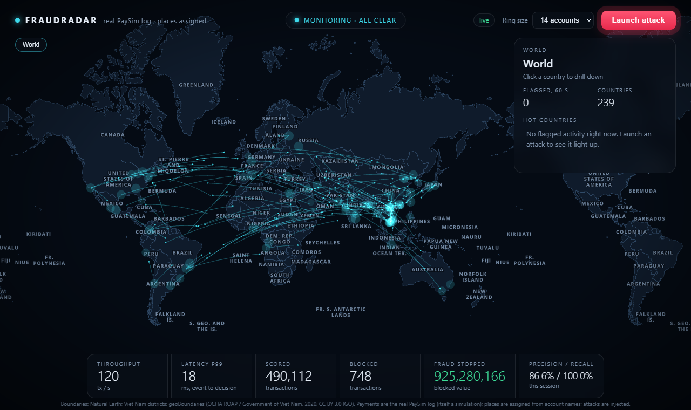
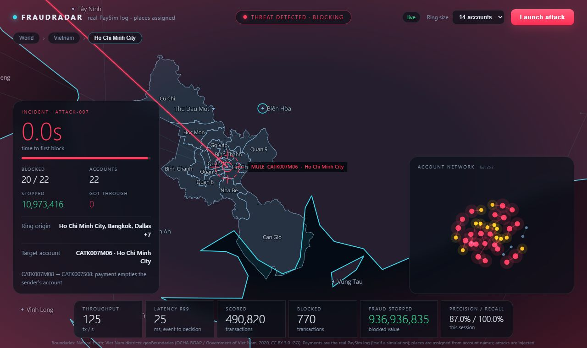
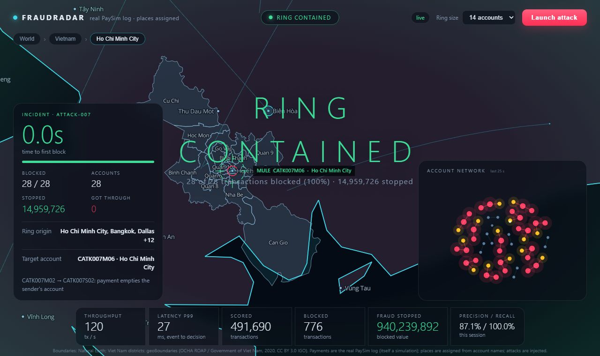
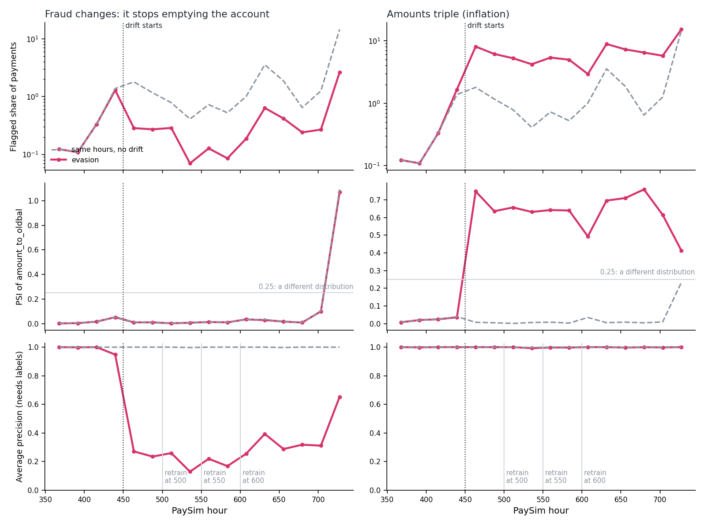

# FraudRadar

[](https://github.com/nguyenhoangkhang-2010/fraudradar-realtime-fraud-detection/actions/workflows/ci.yml)
[](LICENSE)

English: [README.md](README.md)

> **Về bản dịch này.** Bản gốc là [README.md](README.md) (tiếng Anh). Bản tiếng Việt dịch lại toàn bộ nội dung đó; nếu
> hai bản khác nhau thì lấy bản tiếng Anh làm chuẩn. Số liệu, tên lệnh, tên file và thuật ngữ kỹ thuật (PSI, AP, Kafka,
> LightGBM, ...) được giữ nguyên; số dùng định dạng của bản gốc (dấu phẩy ngăn cách hàng nghìn, dấu chấm thập phân).

Một hệ thống phát hiện gian lận thanh toán theo thời gian thực, xây dựng từ đầu đến cuối: các giao dịch chảy qua Kafka,
được chấm điểm từng giao dịch một bằng các feature streaming đúng thời điểm (point-in-time) và mô hình LightGBM, rồi
hiện lên một bản đồ trực tiếp mà bạn có thể phóng to từ cả thế giới xuống tận các quận của một thành phố. Một nút bấm sẽ
chèn vào một băng nhóm gian lận (fraud ring) để bạn xem hệ thống tìm ra nó.

Bài viết đi kèm (tiếng Anh): [Six times my fraud detector's numbers were wrong](docs/blog/building-fraudradar.md), mỗi lần
đối chiếu với thực tế đã tìm ra điều gì.



*Log PaySim thật chảy qua hệ thống trong khi một đợt tấn công được chèn vào bị chặn. PaySim không có vị trí địa lý, nên
các địa điểm được gán từ tên tài khoản; bản đồ chỉ để trang trí, còn điểm số thì không.*

## Dự án này cho thấy điều gì

- **Một hệ thống ML streaming, không phải một notebook.** Redpanda (Kafka) cấp dữ liệu cho scorer; scorer dựng feature từ
  trạng thái *trước* mỗi giao dịch, chấm điểm bằng LightGBM và đăng các quyết định; một gateway FastAPI đẩy chúng qua
  WebSocket tới bản đồ. Khoảng 7 ms từ lúc có sự kiện đến lúc có quyết định ở 120 tx/s trên một laptop; trong
  [bài load test](#load-test), một scorer theo kịp 12,000 đến 16,000 giao dịch mỗi giây và ba scorer theo kịp ít nhất
  24,000 (chạy trên một máy, nên đây là so sánh giữa các thành phần, không phải con số của một cụm máy).
- **Đánh giá có tự kiểm tra.** Cùng một mô hình được đo trên dữ liệu mô phỏng và trên dữ liệu thật, hai kết quả được
  báo cáo cạnh nhau, kèm các điểm yếu ngay bên cạnh.

  | | PaySim (giao dịch mô phỏng, log thật) | IEEE-CIS (giao dịch thẻ thật) |
  |---|---|---|
  | Số giao dịch kiểm thử / gian lận | 1,248,736 / 4,250 | 118,108 / 4,064 |
  | Average precision | 0.9995 | 0.51 |
  | ROC AUC | khoảng 1.0 | 0.90 |
  | Tỷ lệ gian lận bắt được ở ngưỡng chọn trên tập validation | 99.98% với 0.039% báo động nhầm | 44% với 1.3% báo động nhầm |

  Khoảng cách này chính là điểm mấu chốt: gian lận trong PaySim tuân theo một quy tắc do trình mô phỏng viết ra. Chi tiết ở
  [Kết quả mô hình trên PaySim](#model-results-on-paysim) và [Giao dịch thẻ thật: IEEE-CIS](#real-card-payments-ieee-cis).
- **Huấn luyện và phục vụ khớp nhau.** Code phục vụ, khi được nạp từng giao dịch một, tái tạo lại các chỉ số kiểm thử của
  notebook đến từng chữ số đã nêu ([replay](#replaying-the-real-paysim-log)), và pipeline Kafka trực tiếp cho ra đúng
  số lượt chặn nhầm như replay offline trên cùng các dòng dữ liệu.
- **Nó nhận ra khi mô hình bị cũ và thay mô hình mà không cần khởi động lại.** Mỗi scorer theo dõi đầu vào và tỷ lệ gắn cờ
  của chính nó rồi báo cáo lên bản đồ; một lệnh retrain dựng phiên bản mới từ log, cho nó qua một cổng (gate) so với phiên
  bản đang chạy, rồi đưa nó vào dùng thông qua một registry nhỏ mà các scorer theo dõi. Thử trên drift được chèn vào log
  thật: một loại drift chỉ monitor thấy được, một loại chỉ nhãn mới thấy được, và retrain khôi phục được bao nhiêu
  ([Drift và retrain](#drift-and-retraining)).
- **Các lỗi tìm ra nhờ kiểm thử với thực tế**, mỗi lỗi đều đã sửa và ghi lại: một trình mô phỏng có giao dịch hợp lệ
  trông chẳng giống dữ liệu huấn luyện ([kiểm tra skew](#training-serving-skew-check)), một file mô hình mà LightGBM
  không đọc được sau khi Git đổi ký tự xuống dòng, và một Docker image thiếu một thư viện hệ thống.

## Kiến trúc



## Ảnh chụp màn hình

| | |
|---|---|
|  |  |
| Các cung giao dịch trên bản đồ thế giới, chưa có gì bị gắn cờ. | Camera đi theo dòng tiền đến tài khoản mule, xuống tận quận. |
|  | |
| 28 trên 28 giao dịch của ring được chèn vào đã bị chặn. | |

> **Trạng thái:** chạy được từ đầu đến cuối (đường streaming, feature, phục vụ mô hình, test, giao diện, CI). Mặc định
> trạng thái feature nằm trong bộ nhớ của scorer, nên chỉ có một bản sao scorer; `FEATURE_STORE=redis` cho phép nhiều
> scorer dùng chung (xem [Trạng thái feature dùng chung trong Redis](#shared-feature-state-in-redis)). Xem
> [Lộ trình](#roadmap) để biết những gì cố ý chưa làm.

## Chạy thử

Cần Docker.

```bash
docker compose up --build
```

Mở <http://localhost:8000> và bấm **Launch attack**. (Để chạy bản đồ trên log PaySim thật thay cho trình mô phỏng, xem
[Demo trên log PaySim thật](#demo-on-the-real-paysim-log).) Để chấm điểm bằng mô hình LightGBM huấn luyện trên PaySim thay
cho heuristic, xem [Phục vụ mô hình PaySim](#serving-the-paysim-model):

```bash
SCORER=lightgbm docker compose up --build
```

Trang web là một bản đồ phẳng của thế giới mà bạn có thể đào sâu dần: **thế giới, rồi quốc gia, rồi thành phố, rồi quận**.

- Bấm vào một quốc gia để phóng to. Đường biên, thủ đô và các thành phố của nó hiện ra còn các quốc gia khác mờ đi.
- Bấm vào một thành phố để phóng tới nó. Năm thành phố lớn của Việt Nam (Hà Nội, TP. Hồ Chí Minh, Đà Nẵng, Hải Phòng,
  Cần Thơ) mở ra thành các quận của chúng.
- Bấm vào một quận để phóng tới đó. Thanh breadcrumb ở trên cùng, danh sách ở bảng bên và phím `Esc` đều đưa bạn quay lại
  cấp trên.
- Rê chuột lên bất kỳ thứ gì để xem tên và số giao dịch bị gắn cờ của nó trong 60 giây qua.

Khi một ring bị phát hiện, camera đi theo dòng tiền xuống tài khoản mule (quốc gia, rồi thành phố, rồi quận), các làn sóng
xung kích đánh dấu từng giao dịch bị chặn, và một đồ thị tài khoản cùng một thẻ sự cố cho thấy điều gì đã bị bắt. Những
vùng có traffic bị gắn cờ chuyển từ hổ phách sang đỏ. Nếu bạn tự bắt đầu khám phá trong lúc có sự cố, camera sẽ ở yên
đúng chỗ bạn đặt.

Bản đồ, đồ thị mạng và các glyph của font lấy từ CDN hoặc từ repo này như ghi bên dưới, nên trang cần có internet để tải
MapLibre và d3. `/globe.html` là phiên bản 3D-globe cũ hơn của cùng luồng dữ liệu.

Các kiểm tra offline không cần Docker hay Kafka:

```bash
pip install -e ".[dev,model]"
pytest
python -m fraudradar.evaluate
python -m fraudradar.evaluate --scorer lightgbm
python -m fraudradar.skew
```

Những gì test bao phủ ngoài mô hình và feature: API (`tests/test_api.py`) chạy ứng dụng FastAPI thật với một test client
và các đối tượng Kafka giả, nên các endpoint, hub WebSocket và các vòng lặp consumer được chạy thử mà không cần broker
(bản thân kết nối Kafka thì không: đó là việc của các lần chạy Docker ở trên); các metric cuốn chiếu (`test_metrics.py`)
được unit test; còn với trang bản đồ, vốn không có bước build, `test_ui_static.py` kiểm tra rằng các script parse được
(bằng `node`, khi có cài), mọi phần tử mà chúng tìm đều tồn tại, các file được liên kết đều có, và các trường mà script
đọc từ một tick đúng là các trường server gửi. Không có gì điều khiển một trình duyệt thật trong CI; tôi đã kiểm tra
trang bằng tay trên API thật được nuôi bằng engine offline (các tick, KPI, huy hiệu sức khỏe mô hình và luồng Launch
attack cho đến "Ring contained").

## Huấn luyện một mô hình

Huấn luyện tách biệt với việc chạy các dịch vụ và không cần Docker, Kafka hay GPU. Cài các thư viện huấn luyện (LightGBM,
scikit-learn, SHAP, pandas, Polars, DuckDB, JupyterLab) trong một lần:

```bash
conda env create -f environment.yml
```

hoặc, với pip thuần trong một môi trường ảo:

```bash
pip install -r requirements-train.txt
```

Sau đó, trong môi trường đã kích hoạt, làm cho `fraudradar.features` import được từ các notebook mà không kéo theo các
phụ thuộc của dịch vụ:

```bash
pip install -e . --no-deps
```

Giữ các tập dữ liệu tải về trong `training/data/` và các mô hình đã huấn luyện trong `models/`; cả hai đều bị git bỏ
qua. Hãy dẫn link tới tập dữ liệu trong README này thay vì commit nó.

## Cách hoạt động

```
simulator ──► [transactions] ──► scorer ──► [decisions] ──► api ──WebSocket──► trình duyệt
    ▲                                                          │
    └──────────────────────[control]◄──────── POST /api/attack ┘
```

| Dịch vụ | Việc làm |
|---|---|
| `simulator` | Đăng traffic hợp lệ với tốc độ đều. Phát ra một fraud ring khi nhận lệnh `attack`. |
| `scorer` | Tính feature, chấm điểm, quyết định `allow`, `review` hoặc `block`, rồi đăng quyết định. |
| `api` | Đọc các quyết định, giữ metric cuốn chiếu, truyền chúng tới trình duyệt. |
| `redpanda` | Broker tương thích Kafka, một node. |

### Feature (`src/fraudradar/features.py`)

Được tính cho từng giao dịch từ trạng thái *trước* nó, rồi trạng thái mới được cập nhật. Một giao dịch không bao giờ
nhìn thấy chính nó, và `tests/test_features.py` kiểm tra điều đó.

| Feature | Ý nghĩa |
|---|---|
| `new_account` | Người gửi có tuổi tài khoản dưới 7 ngày |
| `amount_z` | Số tiền so với lịch sử của chính người gửi (thang log) |
| `velocity` | Số giao dịch của người gửi trong 60 giây gần nhất |
| `shared_device` | Số tài khoản khác từng thấy trên cùng thiết bị |
| `young_fan_in` | Số tài khoản trẻ khác nhau cùng trả cho một người nhận trong 60 giây |
| `flagged_linked` | Số tài khoản vừa bị chặn gần đây trong nhóm cùng thiết bị, cùng người gửi và chính người gửi |

Ba feature cuối là các tín hiệu kiểu đồ thị, làm cho một ring lộ ra khi từng giao dịch riêng lẻ trông đều hợp lý.

### Dữ liệu

Toàn bộ traffic là dữ liệu tổng hợp, từ `src/fraudradar/generator.py`. Traffic hợp lệ được cố ý làm cho khó chịu: các
cửa hàng nổi tiếng nhận nhiều giao dịch, các tài khoản mới nhưng trung thực, người nhà dùng chung thiết bị, những lần mua
lớn hiếm gặp. Một fraud ring gồm 3 đến 60 tài khoản trẻ dùng chung vài thiết bị, cùng trả cho một mule.

Ground truth đi cùng mỗi giao dịch dưới dạng `truth` để hệ thống có thể được đo. Scorer không bao giờ đọc nó, và có một
test khẳng định điều đó.

<a id="geography"></a>

### Địa lý

Các tài khoản nằm ở 96 "địa điểm hoạt động": 80 địa điểm lớn nhất thế giới cộng các thành phố lớn hơn của Việt Nam, có
trọng số theo căn bậc hai của dân số, với Việt Nam được tăng gấp 4 lần (khoảng một phần tư lưu lượng) để chế độ xem
quận có thứ để hiển thị. Ở Hà Nội, TP. Hồ Chí Minh, Đà Nẵng, Hải Phòng và Cần Thơ, mỗi tài khoản còn có một quận.
**Mọi vị trí đều là mô phỏng.** Không có dữ liệu khách hàng thật nào ở đây.

Dữ liệu bản đồ nằm trong `src/fraudradar/data/` và được dựng bằng `python scripts/build_geodata.py`, script này tải các
nguồn về, đơn giản hóa hình dạng và kiểm tra số lượng quận.

| Dữ liệu | Nguồn | Giấy phép |
|---|---|---|
| Quốc gia, địa điểm có dân cư, thủ đô | [Natural Earth](https://www.naturalearthdata.com/) 50m / 10m | Phạm vi công cộng (public domain) |
| Các quận của Việt Nam | [geoBoundaries](https://www.geoboundaries.org/) gbOpen ADM2 (OCHA ROAP / Chính phủ Việt Nam) | CC BY 3.0 IGO |
| Font nhãn | Glyph Open Sans từ [OpenMapTiles fonts](https://github.com/openmaptiles/fonts) | Apache 2.0 |
| Trình vẽ bản đồ | [MapLibre GL JS](https://maplibre.org/) 5.15.0 | BSD-3-Clause |

Những giới hạn đáng biết:

- **Dữ liệu quận là cơ cấu năm 2020.** Việt Nam đã sáp nhập tỉnh và bỏ cấp quận/huyện vào năm 2025, nên đây là ranh giới
  như trước thời điểm đó. Tên quận không có dấu tiếng Việt, như trong nguồn.
- **Chi tiết quận chỉ có cho năm thành phố.** Lớp tỉnh trong geoBoundaries không khớp với lớp quận ở một số đường biên
  (đa giác tỉnh Hà Nội nuốt cả các quận của Hưng Yên, Hà Nam và Bắc Ninh), nên không thể tự động gán quận cho cả 63 tỉnh.
  TP. Hồ Chí Minh và Đà Nẵng được gán theo không gian và khớp với số lượng đã biết (24 và 8); Hà Nội (30), Hải Phòng (15)
  và Cần Thơ (9) được liệt kê theo tên. Script build in ra từng số lượng và đánh dấu mọi chỗ lệch.
- Hình dạng các quận được đơn giản hóa (khoảng 30 m) và hình dạng quốc gia còn nhiều hơn (khoảng 1 km), nên đường biên đủ
  tốt để hiển thị, không phải để đo đạc. Châu Nam Cực bị bỏ ra.
- Natural Earth hiển thị các đường biên tranh chấp theo cách của họ; ở đây không đưa ra tuyên bố nào về chúng.

## Kết quả cho đến nay

Đo bằng `python -m fraudradar.evaluate` (seed 7, 120 giây ở 150 tx/s, hai ring 14 tài khoản), scorer heuristic:

| Chỉ số | Giá trị |
|---|---|
| Giao dịch hợp lệ bị chặn | 1 trên 18,000 |
| Giao dịch của ring bị chặn | 61 trên 80 (76%) |
| Tài khoản ring bị chặn ít nhất một lần | 27 trên 28 |
| Thời gian đến lần chặn đầu tiên sau khi ring bắt đầu | 2.6 giây và 0.7 giây cho hai ring |

Cùng replay đó với `--scorer lightgbm` nằm trong [Phục vụ mô hình PaySim](#serving-the-paysim-model).

Các kết quả này đến từ dữ liệu tổng hợp do chính dự án này tạo ra, nên chúng cho thấy pipeline chạy đúng. Chúng **không**
cho thấy hệ thống sẽ làm tốt đến đâu trên gian lận thật.

Trong demo trực tiếp trên một laptop (một broker, một scorer, 120 tx/s), giao diện cho thấy độ trễ đầu cuối khoảng 7 ms
p50 và 10 đến 17 ms p99, tính từ thời điểm sự kiện đến lúc có quyết định. Đó là một lần quan sát, không phải load test.

<a id="model-results-on-paysim"></a>

## Kết quả mô hình trên PaySim

Một mô hình LightGBM được huấn luyện bằng `training/paysim_lightgbm.ipynb` trên tập dữ liệu
[PaySim](https://www.kaggle.com/datasets/ealaxi/paysim1) (6,362,620 giao dịch trong 743 giờ). Việc chia dữ liệu theo thời
gian: huấn luyện trên giờ 1-281, chọn ngưỡng cảnh báo trên giờ 282-355, báo cáo trên các giờ 356-743 chưa từng đụng tới.
Mọi thứ dưới đây là phần **kiểm thử**; số liệu thô nằm ở [docs/results/paysim_v1](docs/results/paysim_v1).

| Mô hình | Average precision | Gian lận bắt được | Cảnh báo là gian lận | Giao dịch hợp lệ bị gắn cờ |
|---|---|---|---|---|
| Logistic regression | 0.638 | 63.2% | 66.2% | 0.110% |
| LightGBM, chỉ feature của giao dịch (A) | 0.9995 | 99.98% | 71.0% | 0.139% |
| LightGBM, A + lịch sử (A+B) | 0.9985 | 99.7% | 88.2% | 0.046% |
| **LightGBM, mọi feature (A+B+C)** | **0.9995** | **99.98%** | **89.7%** | **0.039%** |

"Gian lận bắt được", "cảnh báo là gian lận" và "giao dịch hợp lệ bị gắn cờ" được đo với ngưỡng đặt trên tập validation
sao cho khoảng 0.1% giao dịch hợp lệ bị gắn cờ. Cột cuối cho thấy ngưỡng đó thực sự làm gì trên tập kiểm thử, đó là lý do
các dòng không so sánh được với nhau chỉ riêng về precision. Một lần dự đoán mất khoảng 1.8 ms (p99 6 ms) trên một
notebook CPU của Kaggle, một tiến trình; đó không phải load test.

Cách đọc cho trung thực:

- **PaySim dễ.** Hai tín hiệu mạnh nhất là "giao dịch này rút cạn tài khoản người gửi" và tỷ lệ giữa số tiền và số dư.
  Đó chính là quy tắc mà trình mô phỏng PaySim dùng để tạo ra gian lận, nên một mô hình chỉ nhìn giao dịch đã gần như hoàn
  hảo. Điểm số cho thấy pipeline và cách chia dữ liệu là đúng đắn; nó nói rất ít về gian lận ngoài đời thật.
- **Các feature lịch sử và chuỗi không thêm được gì đo đếm được.** Các feature chuỗi không bao giờ kích hoạt trên PaySim
  (giá trị SHAP của chúng bằng không), và chênh lệch AP giữa A, A+B và A+B+C khoảng 0.001. Đó là từ một seed và một cách chia,
  nên hãy coi là nhiễu, không phải bằng chứng rằng nhóm nào giúp hay hại.
- **Precision không so sánh được giữa các dòng.** Ngưỡng của mỗi dòng gắn cờ một tỷ lệ giao dịch hợp lệ khác nhau trên
  tập kiểm thử (cột cuối).
- Tỷ lệ gian lận của PaySim (khoảng 0.13%) là một thuộc tính của bản mô phỏng.

<a id="serving-the-paysim-model"></a>

## Phục vụ mô hình PaySim

`SCORER=lightgbm` làm cho dịch vụ scorer (và `python -m fraudradar.evaluate --scorer lightgbm`) dùng mô hình ở mục trên.
Mô hình là một file văn bản 0.47 MB trong `src/fraudradar/artifacts/paysim_v1/`, cạnh metadata mà notebook đã ghi.
`pip install -e ".[model]"` thêm LightGBM; heuristic không cần gì thêm.

Những gì đã thay đổi để làm được điều đó:

- Một giao dịch giờ có thể mang `kind`, số dư của người gửi và người nhận trước giao dịch, và một cờ merchant, như một
  nguồn dữ liệu ví điện tử thường có. Trình mô phỏng giữ số dư tài khoản luôn cập nhật. Một tài khoản trong fraud ring
  giữ đúng số tiền nó sẽ gửi, nên giao dịch cuối cùng làm cạn nó; mule gom lại những gì đến.
- `payment_features.py` dựng lại 14 đầu vào của mô hình từ luồng dữ liệu, với cùng quy tắc point-in-time như kho feature
  của heuristic. Nó từ chối một mô hình có danh sách feature mà nó không dựng được.
- Các ngưỡng cảnh báo không phải 0.85 và 0.5. Chúng lấy từ metadata của mô hình (điểm tại mức 0.1% và 0.01% giao dịch hợp
  lệ bị gắn cờ trên validation), khoảng 0.004 và 0.006, vì điểm của mô hình bám theo tỷ lệ nền. `BLOCK_THRESHOLD` và
  `REVIEW_THRESHOLD` ghi đè chúng.

Cùng một replay (seed 7, 120 giây ở 150 tx/s, hai ring 14 tài khoản):

| Chỉ số | Heuristic | LightGBM |
|---|---|---|
| Giao dịch hợp lệ bị chặn | 1 trên 18,000 | 33 trên 18,000 (0.18%) |
| Giao dịch của ring bị chặn | 61 trên 80 (76%) | 44 trên 80 (55%) |
| Tài khoản ring bị chặn ít nhất một lần | 27 trên 28 | 28 trên 28 |
| Tiền của ring bị chặn lại | 80% | 54% |

Hãy đọc nó như một lần kiểm tra rằng phần phục vụ chạy đúng, không phải một phán quyết về mô hình:

- **Trình mô phỏng đã được uốn theo mô hình, và điều đó làm phép so sánh thành vòng tròn.** Một ring giờ kết thúc mỗi tài
  khoản bằng một lần rút sạch, đúng như gian lận PaySim trông và đúng điều mô hình đã học. Mô hình bắt mọi lần rút sạch và
  bỏ sót hầu hết các giao dịch nhỏ hơn trước đó, đó là lý do nó chặn được ít tiền hơn heuristic.
- **Traffic hợp lệ không giống của PaySim.** [Kiểm tra skew](#training-serving-skew-check) đã đo: giao dịch hợp lệ của
  PaySim rút cạn tài khoản người gửi 31% số lần còn của trình mô phỏng là 0.1%, và trình mô phỏng không có người gửi nào
  số dư bằng không (PaySim: 33%). Vì vậy 33 lần chặn nhầm ở trên nói lên cách mô hình đối xử với traffic hợp lệ của *trình
  mô phỏng này*, không phải cách nó sẽ đối xử với của PaySim. 20 trong 33 là các lần rút sạch hợp lệ, mà mô hình coi là
  trộm cắp; 13 cái còn lại phụ thuộc vào thang số tiền (trong một replay tương tự, 150 / 1,500 / 5,000 cho 0.10% / 0.20% /
  1.4% giao dịch hợp lệ bị chặn nhầm).
- **Chạy trực tiếp trên Kafka** (Docker Compose, `SCORER=lightgbm`, một laptop, 120 tx/s): giao diện cho thấy khoảng 7 ms
  p50 và 22 ms p99 từ lúc sự kiện đến lúc có quyết định, và một ring 14 tài khoản có 38 trên 45 giao dịch bị chặn, giao
  dịch đầu tiên ngay trong cùng tick. Một lần quan sát, không phải load test. Docker image cần gói hệ thống `libgomp1` cho
  LightGBM; image Python slim không có nó và scorer bị crash khi khởi động cho đến khi Dockerfile cài gói này.
- Một lần dự đoán chạy trong event loop của scorer, một tiến trình; thông lượng khi chịu tải không được đo ở đây.

<a id="demo-on-the-real-paysim-log"></a>

## Demo trên log PaySim thật

Bản đồ có thể chạy trên các dòng của file PaySim thật thay cho trình mô phỏng. Với file CSV nằm trong `training/data/`
(xem ở trên), và cùng cấu hình Docker:

```bash
docker compose -f docker-compose.yml -f docker-compose.paysim.yml up -d --build
```

Trình mô phỏng đăng các dòng của file với tốc độ 120 dòng mỗi giây, bắt đầu từ giờ đầu tiên sau phần validation của mô
hình (giờ 356), nên mọi giao dịch hiển thị đều là giao dịch mà mô hình chưa từng huấn luyện hay tinh chỉnh; hết file thì
nó quay lại từ đầu. Scorer dùng mô hình LightGBM, đọc cùng file đó để dựng lại lịch sử của mọi dòng trước khi chấm dòng
đầu tiên nhận được, và đồng bộ lại theo cách tương tự sau một lần khởi động lại. Hãy chờ khoảng một phút rưỡi trước quyết
định đầu tiên: khoảng 20 giây để tìm dòng bắt đầu và 50 giây để đọc 5.1 triệu dòng trước đó, qua cơ chế chia sẻ file của
Docker trên Windows. Sau đó scorer giữ khoảng 1 GB trạng thái feature. Phần đầu trang ghi "real PaySim log" để không bị
nhầm với trình mô phỏng.

Cái gì thật và cái gì không:

- **Thật:** loại giao dịch, số tiền, cả hai số dư, cờ merchant, bộ đếm giờ và nhãn gian lận của mọi dòng.
- **Bịa ra cho bản đồ:** vị trí của một tài khoản. PaySim không có địa điểm, nên mỗi tên tài khoản được băm ra một trong
  các địa điểm của bản đồ, có trọng số như của trình mô phỏng (khoảng một phần tư rơi vào Việt Nam). Cùng một tài khoản
  luôn ở cùng một chỗ, nhưng chỗ đó không có nghĩa gì; các cung và các quận chỉ để trang trí.
- **Được chèn vào:** nút **Launch attack** thêm gian lận kiểu PaySim (14 tài khoản nạn nhân, mỗi cái bị rút sạch vào một
  tài khoản mới rồi tài khoản đó rút tiền mặt, gắn nhãn `attack-NNN`). Đó chính là mẫu hình mà mô hình đã học, nên mô hình
  bắt hết (28 trên 28 giao dịch bị chặn trong các lần chạy tôi làm). Điều đó cho thấy pipeline phản ứng, không phải kỹ năng
  phát hiện.
- **Gian lận có sẵn trong file** được gắn nhãn theo giờ mà nó rơi vào (`paysim-hNNN`), nên thẻ sự cố và các chỉ số
  precision, recall tính gian lận PaySim thật cùng với các đợt tấn công chèn vào. Để có số liệu trên dữ liệu thật, hãy
  dùng replay ở trên. Số tiền không có ký hiệu tiền tệ vì đơn vị tiền của PaySim không được nêu.

Quan sát trên một laptop có Docker (một broker, một scorer, một tiến trình): duy trì 120 tx/s, khoảng 7 ms p50 và 9 đến
14 ms p99 từ lúc đăng đến lúc có quyết định, một khi scorer đã bắt kịp. Đó là một lần quan sát, không phải load test.

**Chạy trực tiếp khớp với offline.** Sau khi demo đã truyền khoảng 464,000 dòng, nó cho thấy 99 lần chặn nhầm; replay
offline trên 460,000 đến 475,000 dòng đầu của cùng file cũng cho 99. Vậy pipeline Kafka, bước đồng bộ khi khởi động nguội
và kho feature không thêm gì và không làm mất gì so với replay. Đoạn đó của file có tỷ lệ chặn nhầm (0.021%) cao hơn toàn
bộ phần kiểm thử (0.0052%), vì tỷ lệ này thay đổi theo log; đó là do dữ liệu, không phải lỗi của pipeline.

<a id="shared-feature-state-in-redis"></a>

## Trạng thái feature dùng chung trong Redis

Mặc định scorer giữ trạng thái feature trong bộ nhớ của chính nó: một scorer, và khởi động lại là quên hết (demo PaySim
sau đó phải đọc lại file trong một phút). `FEATURE_STORE=redis` chuyển các feature lịch sử của mô hình PaySim vào Redis,
để bất kỳ số bản sao scorer nào cũng dùng chung chúng và một scorer khởi động lại có thể chạy tiếp ngay.

```bash
docker compose down
docker compose -f docker-compose.yml -f docker-compose.paysim.yml -f docker-compose.redis.yml up -d --build --scale scorer=3
```

(Phải `down` trước: topic `transactions` được tạo với 3 partition, và một topic đã tồn tại sẽ giữ nguyên số partition cũ.)

Cách hoạt động:

- **Cái được lưu.** Với mỗi tài khoản đã nhận một giao dịch: số giao dịch và tổng của chúng (`fr:<namespace>:in:<account>`,
  một hash). Đó là tất cả những gì mô hình dùng của lịch sử, nên đó là tất cả những gì được lưu. Bốn cột lịch sử còn lại
  không bao giờ được mô hình đã huấn luyện chia nhánh theo; kho gửi chúng đi dưới dạng thiếu và từ chối một mô hình có
  dùng chúng. Với các dòng PaySim trước điểm bắt đầu của demo, đó là 2.18 triệu người nhận và khoảng 265 MB Redis.
- **Một script cho mỗi giao dịch.** Một script Lua đọc trạng thái của người nhận rồi cộng giao dịch vào; Redis chạy một
  script mà không xen kẽ, nên mỗi giao dịch thấy trạng thái ngay trước nó dù có nhiều bản sao. Scorer gửi cả một batch
  Kafka dưới dạng một pipeline các script và chấm điểm nó bằng một lần gọi mô hình.
- **Nạp một lần.** `docker-compose.redis.yml` chạy một job `warmup` cộng 5.1 triệu dòng trước đó theo từng người nhận rồi
  ghi vào Redis (68 giây ở đây, không tốn gì ở các lần khởi động sau: nó idempotent). Trình mô phỏng chờ job này, lưu lại
  nó đã đi tới đâu và tiếp tục từ đó sau khi khởi động lại. Ở chế độ này nó dừng ở cuối file thay vì quay vòng, vì các dòng
  đã đếm không được đếm hai lần. Scorer không cần CSV.
- **Giao dịch được khóa theo người gửi**, nên ba partition cho phép ba scorer mỗi cái nhận một phần của topic.

Nó đã được kiểm tra với những gì:

| Kiểm tra | Kết quả |
|---|---|
| Feature lịch sử trong Redis so với trong bộ nhớ, từng giao dịch một | giống nhau, đến 1e-9 (test, chạy với Redis thật trong CI) |
| Toàn bộ phần kiểm thử PaySim thật (1.25 M giao dịch) qua Redis, một worker | giống hệt notebook: AP 0.99952, 488 và 65 báo động nhầm |
| Như trên, 3 thread dùng chung trạng thái Redis | AP 0.99952; báo động nhầm 485 và 65 |
| Như trên, 8 thread | AP 0.99952; báo động nhầm 457 và 64 |
| Ba scorer trên ba partition, chạy trực tiếp | khoảng 40 tx/s mỗi cái, tổng 120; một ring được chèn vào bị chặn 28 trên 28 |
| Khởi động lại một scorer | trở lại sau 12 giây (vào lại consumer group), không đọc file, không mất trạng thái |

Hãy đọc với sự cẩn trọng:

- **Thí nghiệm nhiều thread đo cái gì.** Các giao dịch được chia cho các thread theo người gửi, giống cách Kafka chia
  partition cho một topic, và các thread chạy đồng thời, nên hai giao dịch tới cùng một người nhận trên các thread khác
  nhau đến Redis theo thứ tự nào mà các thread tình cờ chạy. Recall không đổi và số báo động nhầm dao động vài phần
  trăm. Nhưng các dòng được chia theo thứ tự file thành từng khối, nên các thread không bao giờ lệch nhau quá xa; các
  partition tụt lại không đều có thể bất đồng nhiều hơn. Các lần chạy nhiều thread không tái lập được đến chữ số cuối
  cùng, và mỗi lần chỉ chạy một lần. Replay bị giới hạn bởi việc đọc CSV trong một thread, nên tốc độ của nó (khoảng
  30,000 dòng/giây ở mọi số thread) không phải là một phép đo khả năng mở rộng.
- **Độ trễ đã cao hơn, và [load test](#load-test) đã tìm ra lý do.** Với ba scorer và Redis, giao diện cho thấy khoảng
  15 ms p50 và 75 ms p99 từ lúc đăng đến lúc có quyết định, so với 7 và 9 ms cho một scorer trong bộ nhớ. Nguyên nhân
  không phải Redis: mặc định LightGBM dùng mọi nhân cho mỗi lần dự đoán, nên mỗi scorer bật hàng chục thread để chấm một
  nhúm giao dịch và ba scorer tranh nhau các nhân. Scorer giờ dùng một thread cho mỗi batch (`LGBM_THREADS`, mặc định 1);
  các số trong bảng ở trên và trong những dòng đầu của demo có trước thay đổi này.
- **Chỉ đường đi của mô hình PaySim được chuyển.** Trạng thái feature của scorer heuristic vẫn nằm trong bộ nhớ, và
  `FEATURE_STORE=redis` với nó bị từ chối. Một node Redis, không có failover. Sau một lần crash, một giao dịch có thể
  bị đếm hai lần hoặc không được đếm. Các feature lịch sử là một phép xấp xỉ giữa các partition theo cấu trúc; với một
  partition hoặc một bản sao thì chúng chính xác.
- Chạy các test Redis bằng `REDIS_URL=redis://localhost:6379/0 pytest`; không có Redis thì chúng bị bỏ qua. Replay file
  thật qua Redis bằng `python -m fraudradar.replay --redis redis://localhost:6379/0 --workers 3`.

<a id="training-serving-skew-check"></a>

## Kiểm tra training-serving skew

Một mô hình chấm điểm bất cứ feature nào được đưa cho nó, nên nếu luồng dữ liệu nạp cho nó các giá trị có phân phối khác
với cái nó đã học, điểm của nó mang một ý nghĩa khác. `python -m fraudradar.skew` chạy trình mô phỏng qua cùng
`PaymentFeatureStore` mà scorer dùng và so sánh từng feature với `reference_stats.json`, file mà notebook ghi từ phần
huấn luyện của PaySim (mục 4b). Nó báo cáo population stability index (PSI) cho từng feature, dưới 0.1 là gần nhau, từ 0.1
đến 0.25 là đã dịch chuyển, trên 0.25 là một phân phối khác; traffic hợp lệ được so với toàn bộ giao dịch PaySim và ring
gian lận được so với gian lận của PaySim. Nó cũng in ra thang số tiền sẽ làm khớp trung vị số tiền, và số lần mô hình chia
nhánh theo từng feature (một feature có 0 lần chia nhánh thì không thể có ảnh hưởng, nên skew của nó vô hại). Tự nó không
thay đổi gì. Ring chỉ có vài chục giao dịch, nên số liệu của nó nhiễu. Tham chiếu là `reference_stats.json`, do notebook
tạo từ phần huấn luyện thật của PaySim (3,820,599 giao dịch, trong đó 3,193 là gian lận) và được commit cạnh mô hình.

**Lần đo đầu tiên** (`python -m fraudradar.skew`, seed 7, 120 giây ở 150 tx/s, traffic hợp lệ so với toàn bộ giao dịch
PaySim). 8 trong 11 feature khác nhau là những feature mà mô hình dùng; 3 cái còn lại không bao giờ được chia nhánh theo.

| Feature | PaySim | Trình mô phỏng | PSI |
|---|---|---|---|
| Giao dịch là `TRANSFER` | 8% | 40% | 2.5 (mọi loại) |
| Giao dịch là `CASH_OUT` / `CASH_IN` | 36% / 22% | 13% / 0% | |
| Giao dịch làm cạn tài khoản người gửi | 31% | 0.1% | 1.8 |
| Số dư của người gửi bằng không | 33% | 0% | 2.8 |
| Số tiền ít nhất gấp 100 lần số dư người gửi | 37% | 0% | 5.4 (tỷ lệ) |
| Giờ trong ngày | đêm thưa vắng, 39% gian lận trước 10:00 | đều | 0.8 |
| Số tiền (trung vị, thang log) | 11.2 | 11.1 | 0.77 |
| Số giao dịch người nhận đã nhận trước đó | trung vị 2 | trung vị 5 | 0.7 |

Nó nói lên điều gì:

- **Mô hình tiền của trình mô phỏng cách xa của PaySim.** Trong PaySim nhiều người gửi không có tiền hoặc gửi nhiều hơn
  số họ có, và một phần ba giao dịch hợp lệ làm cạn tài khoản. Trong trình mô phỏng, người gửi luôn đủ tiền và gần như
  không bao giờ làm cạn. Mô hình chỉ phân biệt được một lần rút sạch hợp lệ với một vụ trộm bằng cách kết hợp nhiều tín
  hiệu này, và trình mô phỏng không bao giờ tạo ra các tổ hợp mà nó đã học.
- **`AMOUNT_SCALE` đứng vững.** Quét nó từ 500 đến 8,000, khoảng cách số tiền nhỏ nhất nằm giữa 1,500 và 1,760, và các
  trung vị khớp nhau trong vòng 0.2 trên thang log. Khoảng cách còn lại là hình dạng của phân phối số tiền, không phải
  mức của nó. Thang làm khớp các trung vị là 1,760; mặc định vẫn ở 1,500.
- **Ring cũng khác gian lận PaySim.** Nó gom tiền vào một mule, nên người nhận có lịch sử dài (trung vị 19 giao dịch
  trước đó), trong khi gian lận PaySim chủ yếu đi tới các tài khoản mới (trung vị 0). Số tiền của nó lớn hơn nhiều
  (trung vị 15.4 so với 12.9 trên thang log). Một số giao dịch của ring bị chặn một phần vì điều đó.
- Chưa sửa ở đây. Làm cho traffic hợp lệ của trình mô phỏng khớp các số này nghĩa là hiệu chỉnh nó theo PaySim, đó là một
  thay đổi thiết kế riêng và sẽ làm phép so sánh với mô hình thêm vòng tròn chứ không bớt.

<a id="replaying-the-real-paysim-log"></a>

## Replay log PaySim thật

Traffic hợp lệ của trình mô phỏng không giống của PaySim (xem ở trên), nên các số đo trên nó nói rất ít về mô hình.
`python -m fraudradar.replay` nạp cho mô hình các dòng của file PaySim thật, theo thứ tự file, qua cùng
`PaymentFeatureStore` và cùng mô hình đi kèm mà scorer dùng, rồi chấm điểm chúng so với các nhãn gian lận. Nó cần file
CSV của tập dữ liệu (không nằm trong repo; tải từ [Kaggle](https://www.kaggle.com/datasets/ealaxi/paysim1) và đặt vào
`training/data/`, thư mục bị git bỏ qua), và mất khoảng một phút rưỡi:

```bash
python -m fraudradar.replay --part test
```

Các feature lịch sử đếm mọi giao dịch trước đó, nên cả file được duyệt theo thứ tự và chỉ phần được chọn mới được chấm.
File CSV dùng ở đây có cùng SHA-256 với file mà mô hình đã được huấn luyện (`16910f90...eea6b`).

Phần kiểm thử (giờ 356-743, chưa từng dùng để huấn luyện hay chọn ngưỡng; 1,248,736 giao dịch, 4,250 gian lận), ở hai
ngưỡng mà notebook đã chọn trên validation:

| | Replay qua code phục vụ | Notebook |
|---|---|---|
| Average precision | 0.99952 | 0.99952 |
| Bị gắn cờ trên ngưỡng review (0.1% giao dịch hợp lệ trên validation): gian lận bắt được | 4,249 trên 4,250 (99.976%) | 99.976% |
| ... cảnh báo là gian lận | 89.698% (488 báo động nhầm) | 89.698% |
| ... giao dịch hợp lệ bị gắn cờ | 0.039% | 0.039% |
| Bị gắn cờ trên ngưỡng block (0.01%): gian lận bắt được | 4,249 trên 4,250 | 99.976% |
| ... cảnh báo là gian lận | 98.493% (65 báo động nhầm) | 98.493% |
| ... giao dịch hợp lệ bị gắn cờ | 0.0052% | 0.0052% |

Kết quả thô: [docs/results/paysim_replay](docs/results/paysim_replay). Điều này cho thấy và không cho thấy gì:

- **Huấn luyện và phục vụ khớp nhau.** Các feature được dựng lại từng giao dịch một bằng code phục vụ tái tạo các feature
  vector hóa của notebook đủ sát để mọi chỉ số ở trên khớp đến từng chữ số đã nêu. Đó là phép kiểm tra mà mục skew không
  làm được trên traffic mô phỏng. Một test cũng kiểm tra rằng chấm điểm theo từng khối cho cùng số liệu như đường đi
  từng-giao-dịch-một của dịch vụ.
- **Nó vẫn là PaySim.** Đây là các con số của mục PaySim một lần nữa, giờ đi qua đường phục vụ. PaySim là một bản mô
  phỏng mà gian lận chủ yếu là "rút cạn tài khoản"; điều này không nói gì về gian lận ngoài đời thật. Một vụ gian lận bị
  sót trong 4,250 không phải dấu hiệu của một mô hình hoàn hảo.
- **Chỉ phần kiểm thử mới là điểm số công bằng.** Notebook dùng phần validation để dừng sớm và chọn ngưỡng, và mô hình huấn
  luyện trên phần train. Replay cũng in cả hai phần đó (AP validation 1.0000, AP train 0.9962); đừng trích chúng làm hiệu
  năng.
- **Tốc độ.** Duyệt và chấm điểm cả 6.36 triệu dòng theo khối mất 94 giây trên một laptop (khoảng 68,000 dòng/giây, một
  tiến trình). Chấm 30,000 dòng đầu từng dòng một qua `ScoringEngine.handle`, như dịch vụ làm, chạy ở khoảng 25,000
  dòng/giây với trung vị 0.04 ms và p99 0.10 ms mỗi giao dịch. Đó là các dòng đầu với gần như không có gian lận, nên ít
  dòng phải trả chi phí cho bước giải thích; đó không phải load test và không tính Kafka.

<a id="real-card-payments-ieee-cis"></a>

## Giao dịch thẻ thật: IEEE-CIS

PaySim là một bản mô phỏng, nên điểm gần như hoàn hảo của nó nói rất ít về gian lận thật. Để xem cùng phương pháp đạt
được gì trên các giao dịch mà không ai viết ra quy tắc gian lận, `training/ieee_cis_lightgbm.ipynb` huấn luyện và kiểm
thử một mô hình LightGBM trên dữ liệu
[IEEE-CIS Fraud Detection](https://www.kaggle.com/competitions/ieee-fraud-detection): 590,540 giao dịch thẻ trực tuyến
thật, đã ẩn danh, của Vesta, 3.5% gian lận, trải trên 182 ngày. Nó chỉ dùng hai file huấn luyện có nhãn và tự chia theo
thời gian: huấn luyện trên ngày 0-100, chọn điểm dừng sớm và các ngưỡng trên ngày 100-140, và báo cáo trên ngày 140-182
(118,108 giao dịch, 4,064 gian lận) mà mô hình chưa từng thấy. Dữ liệu không nằm trong repo; `metadata.json` của notebook
có SHA-256 của cả hai file. Kết quả thô: [docs/results/ieee_cis_v1](docs/results/ieee_cis_v1).

| Mô hình (phần kiểm thử) | Average precision | ROC AUC | Gian lận bắt được ở khoảng 5% báo động nhầm | Cảnh báo là gian lận | Gian lận bắt được ở khoảng 1% báo động nhầm | Cảnh báo là gian lận |
|---|---|---|---|---|---|---|
| Đoán ngẫu nhiên | 0.034 | 0.5 | | | | |
| Logistic regression | 0.165 | 0.796 | 50.7% | 18.4% | 31.6% | 28.5% |
| LightGBM, các cột giao dịch (A) | 0.516 | 0.895 | 63.1% | 29.1% | 45.3% | 56.9% |
| LightGBM, A + lịch sử tài khoản đại diện (B) | 0.508 | 0.900 | 63.4% | 29.5% | 44.1% | 55.4% |

So với PaySim, nơi cùng phương pháp đạt AP 0.9995, dữ liệu thật cho AP khoảng 0.51 và ROC AUC khoảng 0.90. Với ngân sách
khoảng 1 giao dịch hợp lệ trên 100 bị gắn cờ, mô hình bắt được dưới một nửa số gian lận và khoảng 4 trên 10 cảnh báo là
sai. Khoảng cách đó là điểm mấu chốt: nó đo xem bao nhiêu điểm số của PaySim đến từ quy tắc của trình mô phỏng.

Cách đọc:

- **Các feature lịch sử không giúp ích.** AP thấp hơn 0.009 và ROC AUC cao hơn 0.005 khi có chúng: một cách chia và một
  seed, nên là không có khác biệt. Cũng có một dấu hiệu cảnh báo. `email_prior_n`, một bộ đếm chạy các giao dịch trước đó
  theo tên miền email, là feature quan trọng thứ ba của mô hình theo gain (3.3%). Một bộ đếm chạy chỉ có thể tăng, nên nó có
  thể đang đóng vai một chiếc đồng hồ thay vì hành vi, và với các tên miền phổ biến, giá trị của nó trong giai đoạn kiểm
  thử, theo cấu trúc, lớn hơn bất kỳ giá trị nào đã thấy lúc huấn luyện. Một bộ đếm trên cửa sổ gần đây sẽ là phiên bản công
  bằng; nó chưa được chạy.
- **Các "tài khoản" là một phỏng đoán.** Dữ liệu không có số tài khoản, nên các giao dịch dùng chung `card1, card2, card3,
  card5` và `addr1` được coi là một tài khoản (42,946 tài khoản như vậy). Đó là một giả định, không phải sự thật.
- **Con số trên validation là lạc quan.** Mô hình được dừng (762 vòng) và các ngưỡng được chọn trên phần validation, nơi AP
  của nó là 0.63. AP kiểm thử 0.51 mới là con số trung thực. Các ngưỡng đặt cho 5% và 1% báo động nhầm cho ra 5.4% và 1.3%
  trên phần kiểm thử, một lệch nhẹ.
- **Không thấy suy giảm trong vòng 70 ngày.** Chấm trên bốn lát cắt liên tiếp của giai đoạn kiểm thử, ROC AUC nằm trong
  khoảng 0.890 đến 0.904. AP tăng từ 0.45 lên 0.56, nhưng AP phụ thuộc vào tỷ lệ gian lận (2.9% đến 4.1% giữa các lát cắt)
  và mỗi lát cắt chỉ có khoảng 1,000 ca gian lận, nên hãy đọc nó là nhiễu, không phải cải thiện.
- **Baseline tuyến tính không hội tụ** sau 200 vòng lặp, nên dòng của nó chỉ là một cận dưới lỏng.
- **Nhiều đầu vào không giải thích được.** Các cột `V` ẩn danh chiếm 37% gain, và hai feature quan trọng nhất là `V258` và
  `V257`.
- **Đây không phải con số trên bảng xếp hạng.** Cuộc thi chấm một giai đoạn khác, muộn hơn và không có nhãn, và các bài
  đứng đầu dùng nhiều feature engineering hơn nhiều.

<a id="load-test"></a>

## Load test

`python scripts/load_matrix.py` (cần Docker và file CSV PaySim) dựng lại stack cho từng cấu hình scorer và chạy
`fraudradar.loadtest` bên trong mạng Compose, nên mọi đồng hồ đều là cùng một đồng hồ. Bộ sinh tải là **vòng hở (open
loop)**: nó đăng các dòng PaySim thật lên Kafka với tốc độ cố định bất kể các scorer làm gì, nên một scorer không theo kịp
sẽ hiện ra dưới dạng độ trễ và sự thiếu hụt thay vì làm chậm phép thử. Độ trễ được đo từ lúc một giao dịch được đăng đến
lúc quyết định của nó quay lại bộ sinh tải. Các bước là 15 giây ở 250 đến 8,000 giao dịch/giây, rồi 6 giây ở 12,000 đến
24,000 (cả bảy cấu hình đều chạy dải thấp, bốn cấu hình chạy cả dải cao; kết quả thô ở
[docs/results/load_test](docs/results/load_test)). `docker stats` được lấy mẫu mỗi giây để mỗi bước có lượng CPU mà các
scorer, Redis và broker đã dùng. "Theo kịp" bên dưới nghĩa là ít nhất 99% tốc độ mục tiêu được quyết định trong bước và
p99 dưới 100 ms.

| Cấu hình | Tốc độ cao nhất theo kịp (tx/s) | p50 / p99 ở đó (ms) | CPU của scorer bận nhất ở đó | Tốc độ đầu tiên không theo kịp |
|---|---|---|---|---|
| Heuristic, trạng thái trong bộ nhớ, 1 scorer (giao dịch tổng hợp) | 16,000 | 6 / 13 | 85% | 24,000 (16,705/s được quyết định, p99 3.1 s) |
| LightGBM, trạng thái trong bộ nhớ, 1 scorer, từng giao dịch một | 12,000 | 10 / 50 | 92% | 16,000 (14,243/s, p99 0.7 s) |
| LightGBM, Redis, 1 scorer, theo batch | 16,000 | 12 / 56 | 76% | 24,000 (21,031/s, p99 0.8 s) |
| LightGBM, Redis, 2 scorer, 2 partition | 8,000 (cao nhất đã thử) | 8 / 12 | 41% | chưa đạt tới |
| LightGBM, Redis, 3 scorer, 3 partition | 24,000 (cao nhất đã thử) | 9 / 32 | 62% | chưa đạt tới |

(CPU là phần trăm của một nhân, như `docker stats` báo cáo.) Nó cho thấy:

- **Các scorer bị giới hạn bởi một tiến trình Python, không phải bởi mô hình hay Redis.** Mọi cấu hình đã bão hòa đều dùng
  khoảng một nhân, và heuristic, vốn không có mô hình, bão hòa trong cùng khoảng với LightGBM cộng Redis (16,000 đến
  24,000/s). Chi phí cho mỗi giao dịch là client Kafka và JSON, đó là lý do thêm partition và scorer có tác dụng: ba scorer
  chưa bão hòa ở 24,000/s, tốc độ cao nhất đã thử (bản thân bộ sinh tải cũng là một tiến trình Python).
- **Batch bù lại hơn cả chi phí của Redis.** Một scorer có trạng thái trong Redis theo kịp 16,000 giao dịch/giây; với trạng
  thái trong bộ nhớ và một dự đoán cho mỗi giao dịch thì là 12,000. Chuyển trạng thái ra ngoài tốn bộ nhớ ở nơi khác thay vì
  trong scorer: scorer LightGBM trong bộ nhớ giữ khoảng 1.04 GiB, mỗi scorer dùng Redis 57 MiB cộng khoảng 280 đến 300 MiB
  trong Redis.
- **Số thread là vấn đề độ trễ trước đó.** Ở 250 giao dịch/giây, LightGBM dùng mọi nhân (mặc định của nó) so với một
  thread cho mỗi batch:

  | | p50 / p99 (ms) | CPU của mỗi scorer |
  |---|---|---|
  | 1 scorer, mọi nhân | 14 / 47 | 1,808% |
  | 1 scorer, 1 thread | 8 / 10 | 26% |
  | 3 scorer, mọi nhân | 80 / 223 | khoảng 560% mỗi cái |
  | 3 scorer, 1 thread | 9 / 12 | 12% mỗi cái |

  Với mọi nhân, một scorer tốn khoảng mười tám nhân CPU để chấm 250 giao dịch mỗi giây, và ba cái làm chậm lẫn nhau:
  trung vị cao hơn khoảng mười lần. Ở 8,000 giao dịch/giây, một scorer dùng mọi nhân có p50 35 ms và p99 94 ms.
- **Ở tải thấp, trung vị là 6 đến 9 ms ở mọi cấu hình một thread.** Trong đó, 2 đến 3 ms là thời gian cho đến khi scorer
  quyết định xong; phần còn lại là chặng đường quay về của quyết định. Mức sàn này chưa được phân tích sâu hơn.

Những gì không được thể hiện:

- Mọi thứ chạy trên một laptop 20 nhân: công cụ này, broker, Redis và các scorer dùng chung các nhân của nó. Các con số so
  sánh các thành phần với nhau; chúng không phải những gì một cụm máy sẽ làm.
- Một lần chạy cho mỗi ô, 15 giây (6 giây trên 8,000). Dòng 2 scorer dừng ở 8,000 giao dịch/giây, và dòng 3 scorer dừng ở
  24,000 vì đó là tốc độ cao nhất đã thử, nên giới hạn thật của chúng là chưa biết.
- Dòng heuristic dùng bộ sinh dữ liệu tổng hợp; các dòng khác dùng các dòng PaySim thật, nên số liệu của nó không hoàn toàn
  so sánh được.
- Độ trễ ở đây gồm cả phần lập lịch của chính bộ sinh tải (tối đa vài mili giây) và là cho các giao dịch được chấm theo
  từng batch Kafka; không có văn bản giải thích nào được yêu cầu ngoại trừ cho các giao dịch bị gắn cờ, vốn là một phần
  rất nhỏ.

<a id="drift-and-retraining"></a>

## Drift và retrain

Một mô hình bị cũ khi traffic thôi giống với cái nó đã học, và trong gian lận thì những kẻ ở phía bên kia thay đổi hành vi
một cách có chủ đích. Phần này thêm các mảnh để nhận ra điều đó và để thay mô hình mà không dừng các scorer. Tất cả đều
được chạy thử trong thí nghiệm bên dưới; không cái nào từng gặp drift không do chèn vào, vì log PaySim không có một sự
đổi chế độ thật nào.

- **Monitor** (`drift.py`). Mỗi scorer LightGBM giữ các dòng feature và cờ của 20,000 giao dịch gần nhất và, cứ 10 giây,
  đăng một báo cáo lên topic `drift`: population stability index của từng feature so với phần huấn luyện
  (`reference_stats.json`, phép đo mà [kiểm tra skew](#training-serving-skew-check) dùng), chỉ tính các feature mà mô hình
  chia nhánh theo, và tỷ lệ giao dịch bị gắn cờ so với cửa sổ đầy đủ đầu tiên sau khi mô hình bắt đầu chạy. API phục vụ báo
  cáo mới nhất của từng scorer tại `/api/drift`, và thanh trên của bản đồ hiện một huy hiệu (khỏe, theo dõi, đang drift) kèm
  lý do khi rê chuột. Scorer trả giá khoảng 8 µs cho mỗi giao dịch cho việc này (một lần gọi engine 40 µs thành 48 µs
  trong một microbenchmark) và 7 ms cho mỗi báo cáo cứ 10 giây.
- **Retrain** (`python -m fraudradar.retrain --now 600 --promote`, `retrain.py`). Việc huấn luyện của notebook thành một
  lệnh: feature đến từ code phục vụ, nhãn chỉ được dùng đến `now - label_delay` (mặc định 48 giờ), các giờ có nhãn mới nhất
  được chia thành một phần validation (dừng sớm và hai ngưỡng) và một phần *gate* mà không mô hình nào đã được tinh chỉnh
  trên đó, và phiên bản mới được ghi cùng `reference_stats.json` riêng của nó và một báo cáo. `build_reference` tái tạo
  chính xác tham chiếu của notebook (đã kiểm tra với cái đã commit trên phần huấn luyện thật: cùng 3,820,599 dòng và 3,193
  ca gian lận, cùng kiểu bin, phần chia của các bin sai khác trong vòng 3e-7 và biên của các bin trong vòng 6e-7).
- **Gate.** Mô hình ứng viên (challenger) chỉ thay mô hình đang chạy nếu nó thêm được 0.002 average precision trên phần
  gate, hoặc nếu mô hình đang chạy đã trượt khỏi mục tiêu báo động nhầm của nó (trên 3 lần mức 0.1% nó được đặt) và
  challenger giảm ít nhất một nửa mức đó mà không mất chất lượng xếp hạng; một challenger trên 5 lần mục tiêu thì không
  bao giờ được vào. Quy tắc thứ hai tồn tại vì trường hợp lạm phát bên dưới, nơi average precision không hề nhúc nhích.
- **Registry** (`registry.py`, `models/`). Các phiên bản nằm cạnh nhau và `current.json` chỉ ra phiên bản đang chạy; việc
  đưa một phiên bản vào dùng, hoặc đưa lại một phiên bản cũ hơn, là một lần ghi lại file nguyên tử (atomic), với mỗi lần
  chuyển được ghi vào `history.jsonl`. Các scorer khởi động với `MODEL_REGISTRY=/models` (mặc định của Compose; thư mục này
  bị git bỏ qua) xem con trỏ mỗi 5 giây và chuyển giữa hai batch, giữ nguyên trạng thái feature của chúng. Một phiên bản mà
  kho feature đang chạy không phục vụ được (cột khác, hoặc một kho Redis bị yêu cầu dùng một feature mà nó không lưu) sẽ
  được ghi log và bị từ chối, và mô hình cũ tiếp tục chấm điểm. Đã thử trực tiếp trên stack đang chạy: chuyển sang
  `v2-evasion` in ra `now serving model v2-evasion (was paysim_v1)` trong vòng một giây, chuyển sang một phiên bản có danh
  sách feature bị hỏng in ra `not switching ... still serving v2-evasion`, và `python -m fraudradar.registry promote
  paysim_v1` đã quay lui được.

### Thí nghiệm

`python scripts/drift_experiment.py` chèn drift vào log PaySim thật từ giờ 450 trở đi (các `scenario` trong `drift.py`),
rồi làm hai việc, với cùng các cửa sổ thật, nguyên vẹn làm nhóm đối chứng. Mô hình đang chạy là mô hình đi kèm (huấn luyện
trên giờ 1 đến 281, tinh chỉnh trên 282 đến 355).

1. Một lần quét, từng cửa sổ 24 giờ trên phần kiểm thử của mô hình (giờ 356 đến 743): hai tín hiệu của monitor, và average
   precision mà mô hình thực sự có (thứ cần có nhãn).
2. Retrain như nó sẽ xảy ra ở các giờ 500, 550 và 600 với 48 giờ trễ nhãn, và, làm đối chứng, ở giờ 640 với nhãn tức thì.
   Mọi challenger, bất kể gate nói gì, sau đó được đo trên các giờ 650 đến 743, mà cả nó lẫn mô hình đang chạy chưa từng
   thấy (1,038 ca gian lận).



*Đường xám đứt nét: cùng các giờ đó của log thật khi không chèn gì. Cửa sổ cuối có ít giao dịch và tỷ lệ gian lận 15%.*

**Bản thân log thật tự làm gì.** Trước khi chèn bất cứ gì, lần quét cho thấy monitor báo động giả
([docs/results/drift_retrain/scan_natural.txt](docs/results/drift_retrain/scan_natural.txt)). Từ giờ 404 trở đi, traffic
hợp lệ của PaySim sụp đổ (96,000 giao dịch một ngày, rồi 17,000, rồi 7,000) trong khi gian lận vẫn ở khoảng 11 ca mỗi giờ,
nên tỷ lệ gian lận đi từ 0.1% lên 1 đến 15%, phân phối giờ-trong-ngày của traffic đổi (PSI của `hour` 0.6 đến 3.6 từ giờ
404, so với 0.02 đến 0.03 trước đó) và tỷ lệ gắn cờ đi theo tỷ lệ gian lận. Mô hình không bị ảnh hưởng: average precision
ở mức 0.997 đến 1.000 trong mọi cửa sổ. Vậy "PSI tệ nhất" đỏ trong phần lớn log thật, và một phép thử tỷ lệ gắn cờ so với
baseline cố định kêu vì lý do sai (tỷ lệ nền đã dịch, không phải mô hình). Không tín hiệu nào là một phán quyết; chúng chỉ
nói nên nhìn vào đâu.

**Lạm phát: mọi số tiền nhân ba (covariate drift).**

- Monitor thấy ngay và rõ: PSI của `amount_log` là 0.49 đến 0.76 trong mọi cửa sổ từ giờ 452 đến 715, so với nhiều nhất
  0.04 ở nhóm đối chứng, và tỷ lệ gắn cờ gấp 2.5 đến 10 lần của nhóm đối chứng (2.9 đến 8.9% so với 0.4 đến 3.6%).
- Average precision không thấy gì cả: 0.993 đến 1.000 suốt. Thứ hạng của các giao dịch vẫn đúng. Nhưng ở ngưỡng review cố
  định của mô hình, trên các giờ giữ lại, 5.5% giao dịch hợp lệ bị gắn cờ so với 0.1% mà nó được đặt, và chỉ 19% số cờ là
  gian lận, với recall là 1.000. Một dashboard chỉ theo dõi average precision hay recall sẽ gọi mô hình này là khỏe trong
  khi các nhà phân tích chìm trong cảnh báo.

**Né tránh: gian lận thôi rút cạn tài khoản (concept drift).** Từ giờ 450, một giao dịch gian lận lấy 20 đến 80% số dư,
không phải tất cả, điều mà gian lận của PaySim luôn làm và điều mô hình đã học.

- Average precision rơi từ 0.95 xuống 0.27 trong cửa sổ đầy đủ đầu tiên và nằm trong khoảng 0.13 đến 0.39; recall ở ngưỡng
  review rơi xuống 0.10 đến 0.27. Trên các giờ giữ lại: average precision 0.303, recall 0.205.
- Các tín hiệu không nhãn không tách riêng được nó. Không một feature nào có phân phối dịch chuyển: PSI của
  `amount_to_oldbal` là 0.00 đến 0.03 trong mọi cửa sổ đến giờ 691, giống nhóm đối chứng, và của `drains_account` là 0.00
  đến 0.01, vì gian lận chỉ là 0.1 đến 0.3% số dòng và không làm dịch một decile nào. Tỷ lệ gắn cờ có giảm, từ 1.29% xuống
  0.28% giữa hai cửa sổ liên tiếp (0.07 đến 0.63% sau đó), nhưng nhóm đối chứng cũng dịch chuyển nhiều như vậy giữa các cửa
  sổ mà không có drift nào (0.33% lên 1.38% từ giờ 404 đến 451, theo chiều ngược lại), nên không có phản thực tế
  (counterfactual) thì một lần giảm trông như nhiễu của tỷ lệ nền ở trên. Bắt được cái này cần có nhãn, thứ mà trong một
  hệ thống thật đến trễ vài ngày, hoặc một tín hiệu chuẩn hóa theo tỷ lệ gian lận; dự án này chưa có.

**Retrain.** Mô hình đang chạy trên các giờ giữ lại, và từng challenger:

| Kịch bản | Retrain ở giờ | Nhãn đã biết đến | Gian lận đã drift trong huấn luyện / validation | Gate | AP trên tập giữ lại | Recall trên tập giữ lại | Báo động nhầm trên tập giữ lại |
|---|---|---|---|---|---|---|---|
| Né tránh | đang chạy | | | | 0.303 | 0.205 | 0.033% |
| | 500 | 452 | 0 / 0 | đạt | 0.380 | 0.237 | 0.163% |
| | 550 | 502 | 0 / 188 | đạt | 0.396 | 0.265 | 0.020% |
| | 600 | 552 | 308 / 394 | đạt | 0.884 | 0.768 | 0.080% |
| | 640, nhãn tức thì | 640 | 1,246 / 364 | đạt | 0.902 | 0.817 | 0.129% |
| Lạm phát | đang chạy | | | | 0.9985 | 1.000 | 5.487% |
| | 500 | 452 | 0 / 0 | **trượt** | 0.9977 | 1.000 | 5.414% |
| | 550 | 502 | 0 / 188 | **trượt** | 0.9850 | 0.995 | 0.322% |
| | 600 | 552 | 308 / 394 | đạt | 0.9998 | 1.000 | 0.098% |
| | 640, nhãn tức thì | 640 | 1,246 / 364 | đạt | 0.9993 | 1.000 | 0.112% |

(Recall và báo động nhầm trên tập giữ lại được tính ở ngưỡng review riêng của từng mô hình; mục tiêu báo động nhầm là
0.100%.)

- **Retrain chỉ giúp được khi các ví dụ có nhãn của hành vi mới đã vào phần huấn luyện.** Né tránh bắt đầu ở giờ 450; lần
  retrain ở giờ 500 chỉ thấy nhãn đến giờ 452, nên nó huấn luyện trên hành vi cũ và thu được 0.08 average precision, còn
  lần ở giờ 550 không huấn luyện trên chút nào của nó (188 ca drift của nó đi vào validation). Lần ở giờ 600, với 308 ca
  gian lận drift trong huấn luyện, khôi phục lên 0.884. Chờ nhãn tốn khoảng 150 giờ với một mô hình bỏ sót bốn trong năm
  ca gian lận. Với nhãn tức thì ở giờ 640 kết quả là 0.902, chỉ tốt hơn một chút so với có độ trễ ở giờ 600, nên độ trễ
  quan trọng nhất trong một trăm giờ đầu.
- **Với lạm phát, retrain là về ngưỡng, không phải về thứ hạng.** Ở giờ 600, báo động nhầm của challenger trở về 0.098% so
  với 5.5%, với average precision không đổi (0.9998 so với 0.9985).
- **Gate đã từ chối hai mô hình, trong đó có một cái đáng lẽ nên nhận.** Ở giờ 500 chưa có gì drift trong phần gate và
  challenger không tốt hơn, nên "không" là đúng. Ở giờ 550, challenger giảm báo động nhầm từ 5.1% xuống 0.38% trên phần
  gate nhưng mất 0.018 average precision ở đó (huấn luyện chỉ trên dữ liệu trước drift, dữ liệu drift chỉ dùng để dừng
  sớm), nên quy tắc đã từ chối nó; trên các giờ giữ lại nó sẽ giảm báo động nhầm từ 5.5% xuống 0.32% với cái giá 0.013
  average precision. Đánh đổi bao nhiêu thứ hạng lấy báo động nhầm là một lựa chọn kinh doanh mà quy tắc cố định ở mức
  "không". Theo chiều ngược lại, gate đã cho qua lần retrain né tránh ở giờ 500 với mức tăng 0.0045 trên một cửa sổ gate
  chưa có gì drift: một mức tăng cỡ đó nằm trong khả năng một seed khác có thể tạo ra, nên 0.002 là một ngưỡng thấp.

Điều này không cho thấy:

- **Mọi thứ drift ở đây đều do chèn vào**, trên một tập dữ liệu mô phỏng, theo hai cách chọn bằng tay. Nó cho thấy bộ máy
  chạy được và mỗi tín hiệu thấy và không thấy được gì; nó không nói gì về việc gian lận thật drift thường xuyên đến đâu,
  hoặc theo cách nào.
- Một lần chạy cho mỗi ô, một seed; không có khoảng tin cậy. Đoạn giữ lại có 1,038 ca gian lận, đủ cho các hiệu ứng lớn ở
  trên và không đủ cho những hiệu ứng nhỏ (0.002 average precision).
- Các giới hạn của monitor (PSI trên 0.1 và 0.25, z-score tỷ lệ gắn cờ trên 4) là các quy tắc ngón tay cái thông dụng,
  chưa được tinh chỉnh, và, như nhóm đối chứng cho thấy, chúng kêu trên một dịch chuyển của tỷ lệ nền mà không làm hại mô
  hình.
- Không có gì tự khởi động một lần retrain. Lệnh đã có và an toàn để đặt lịch; phần kích hoạt (một job theo dõi các báo
  cáo, chờ nhãn và chạy nó) thì chưa có. Monitor cũng không bao giờ thấy nhãn: nối các nhãn đến trễ vào nó (recall trên
  gian lận đã xác nhận của tuần trước) là mảnh còn thiếu cho concept drift.
- Retrain đọc toàn bộ CSV và mất khoảng hai phút cho feature và khoảng 20 giây để fit; đó là một job batch, không phải
  việc một scorer làm.

<a id="roadmap"></a>

## Lộ trình

- [x] Huấn luyện một mô hình LightGBM trên PaySim và báo cáo trung thực (xem ở trên)
- [x] Phục vụ mô hình đó trong scorer thay cho `HeuristicScorer` (bật bằng `SCORER=lightgbm`)
- [x] Chuyển trạng thái feature của mô hình PaySim sang Redis để nhiều bản sao scorer có thể chạy, trên một topic 3 partition (xem ở trên); trạng thái của heuristic vẫn nằm trong bộ nhớ
- [x] Replay log PaySim thật qua code phục vụ và so với notebook (xem ở trên)
- [x] Benchmark trên giao dịch thẻ thật (IEEE-CIS), xem ở trên
- [x] Demo trên log PaySim thật (`docker-compose.paysim.yml`)
- [ ] IEEE-CIS tiếp theo: bộ đếm lịch sử theo cửa sổ thay cho bộ đếm chạy, và nhiều seed/cách chia
- [ ] Hiệu chỉnh trình mô phỏng theo một tập dữ liệu công khai (ví dụ IEEE-CIS hoặc PaySim); kiểm tra skew liệt kê những gì đang lệch
- [x] Load test, với p50/p99 khi thông lượng tăng dần (xem ở trên)
- [x] Monitor drift, lệnh retrain có gate, và một model registry mà các scorer theo dõi trực tiếp (xem ở trên)
- [ ] Tự khởi động retrain khi monitor báo drift, khi nhãn đã đến
- [ ] Đưa các nhãn gian lận đến trễ vào monitor (recall trên gian lận đã xác nhận), và một tín hiệu tỷ lệ gắn cờ chuẩn hóa theo tỷ lệ gian lận
- [x] Kiểm tra training-serving skew, với lần đo đầu tiên so với phần huấn luyện PaySim thật (xem ở trên)
- [ ] Feature lineage

## Cấu trúc thư mục

```
scripts/
  build_geodata.py  tải về và dựng các tập dữ liệu bản đồ
  load_matrix.py    chạy load test với từng cấu hình scorer
  drift_experiment.py  chèn drift vào log PaySim, quét nó, retrain và đo
  plot_drift.py     vẽ docs/img/drift_retrain.png từ kết quả của thí nghiệm
src/fraudradar/
  geo.py         các địa điểm hoạt động và quận, dùng chung bởi trình mô phỏng và bản đồ
  data/          quốc gia, địa điểm và quận dưới dạng GeoJSON (đã dựng, có commit)
  generator.py   traffic tổng hợp và các fraud ring
  features.py    feature streaming cho heuristic, đúng thời điểm (point-in-time)
  payment_features.py  14 đầu vào của mô hình PaySim, dựng từ luồng dữ liệu
  model.py       scorer heuristic và các ngưỡng
  lgbm.py        nạp mô hình LightGBM đã huấn luyện và giải thích điểm của nó
  artifacts/     mô hình đã huấn luyện, metadata của nó và reference_stats.json
  skew.py        kiểm tra training-serving skew, và `build_reference` (tham chiếu của notebook, dưới dạng code)
  drift.py       monitor drift, các kịch bản drift chèn vào, lần quét theo cửa sổ của log
  retrain.py     retrain từ log, gate so với mô hình đang chạy
  registry.py    các phiên bản mô hình và con trỏ mà các scorer theo dõi
  replay.py      replay log PaySim thật qua code phục vụ
  loadtest.py    bộ sinh tải vòng hở và báo cáo độ trễ
  paysim_stream.py  log PaySim làm traffic trực tiếp của demo
  redis_features.py các feature lịch sử của mô hình PaySim trong Redis (dùng chung bởi các bản sao scorer)
  paysim_warmup.py  nạp lịch sử trước điểm bắt đầu của demo vào Redis, một lần
  serving.py     dựng engine cho một tên scorer
  engine.py      feature -> điểm -> hành động
  evaluate.py    replay offline và các chỉ số
  simulator/     producer Kafka + bộ lắng nghe control
  scorer/        consumer/producer Kafka bao quanh engine
  api/           FastAPI, hub WebSocket, metric, giao diện tĩnh (bản đồ, font)
tests/
```

## Giấy phép

Code được phát hành theo [giấy phép MIT](LICENSE). Dữ liệu bản đồ và font nhãn giữ giấy phép riêng của chúng, được liệt kê
ở mục [Địa lý](#geography); phải ghi công các nguồn như mô tả ở đó.
