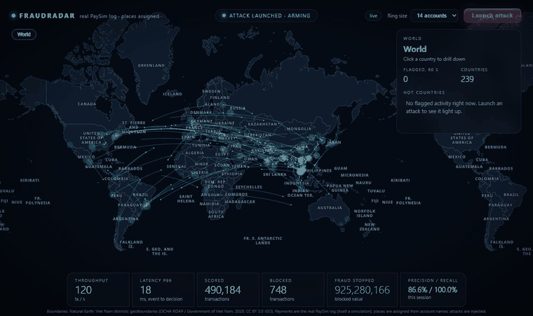
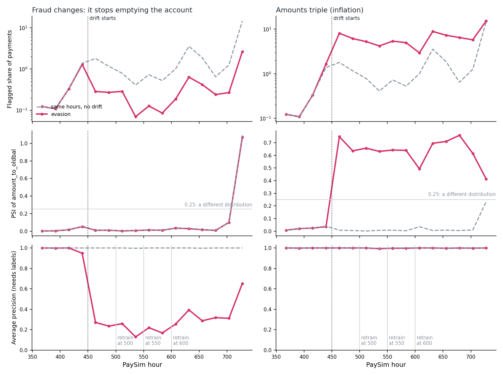

# Six times my fraud detector's numbers were wrong

I built FraudRadar, a real-time payment-fraud detector: payments stream through Kafka, a scorer builds features from
the state *before* each payment, scores it with LightGBM and publishes a decision, and a map shows the result live.
The first version looked great. It took a series of further checks against reality to find out how much of that was
real. This post is the list of what each check found, because that list is more useful than the architecture diagram.

*The real PaySim log streaming through the system while an injected attack is blocked. PaySim has no locations, so the
places on the map are assigned from account names; the map is decoration, the scores are not.*

The rule I ended up with: **every number has to be measured against something that can disagree with it**, and the
disagreement gets written down next to the number. The code is on GitHub
([nguyenhoangkhang-2010/fraudradar-realtime-fraud-detection](https://github.com/nguyenhoangkhang-2010/fraudradar-realtime-fraud-detection));
every figure below links to where it is measured in the README.

## 1. A near-perfect score that meant little

I trained LightGBM on [PaySim](https://www.kaggle.com/datasets/ealaxi/paysim1) (6.36 million simulated mobile-money
payments), split by time so the model is tested on hours it never saw. On 1,248,736 test payments with 4,250 fraud
cases it reached average precision 0.9995 and caught 4,249 of 4,250 frauds.

Then I looked at why. The two strongest features are "this payment empties the sender's account" and the ratio of the
amount to the balance, and that is precisely the rule PaySim's simulator uses to *create* fraud. A model that learns the
generator's rule scores perfectly and has learned nothing about fraud.

So I ran the same method on real data, the [IEEE-CIS](https://www.kaggle.com/competitions/ieee-fraud-detection)
card-payment set (590,540 real online payments, 3.5% fraud). The result: average precision about 0.51, ROC AUC 0.90. At
a budget of one honest payment in a hundred flagged, the model catches about 45% of the fraud and roughly 4 in 10 alerts
are wrong. That gap is the finding. It measures how much of 0.9995 came from the simulator.

I report both numbers side by side in the README. The weaker one is the one a reviewer should trust.

## 2. My own simulator looked nothing like the training data

The demo needed live traffic, so I wrote a traffic simulator with fraud rings. Its honest payments looked plausible to
me. I wrote a skew check to measure that instead of believing it: replay the simulator through the same feature code the
scorer uses, and compare each feature's spread with the training data using the population stability index (PSI).

It was far off. In PaySim, 31% of honest payments empty the sender's account; in my simulator, 0.1%. A third of PaySim's
senders have a zero balance; mine had none. Eight of the eleven features that differed are ones the model actually uses.
The model could only separate a sweep from a theft by combining several signals, and my simulator never produced the
combinations it had learned.

Consequence: the first end-to-end numbers (33 of 18,000 honest payments blocked) described how the model treats *my
simulator*, not how it treats payments. I stopped quoting them as model quality, and added a mode where the demo streams
the real PaySim rows instead.

## 3. "Training and serving agree" is a claim you have to test

A model trained in a notebook is served by different code, one payment at a time. If the two compute features slightly
differently, the notebook's metrics describe a model nobody is running. I replayed the real test part through the exact
serving code and compared with the notebook: average precision 0.99952 in both, and 488 and 65 false alarms at the two
thresholds in both. The live Kafka pipeline then produced 99 false blocks over the same rows where the offline replay
produced 99.

The same discipline caught two plain bugs that no unit test would have:

- Git on Windows rewrote the model file's line endings, and LightGBM refuses to parse a CRLF model. The loader now
  normalises them, and a regression test covers it.
- The slim Docker image lacked a system library LightGBM needs (`libgomp1`), so the scorer crashed on start in the
  container while passing every test outside it.

## 4. Scaling out, and a latency hypothesis I got wrong

One scorer keeps its feature state in memory, so it cannot be replicated. I moved the history features to Redis (one Lua
script per payment so each payment reads the state before itself, a whole Kafka batch per round trip) and ran three
scorers on three partitions. Latency got worse: about 15 ms p50 and 75 ms p99, against 7 and 9 ms for one in-memory
scorer.

I assumed Redis round trips. I was wrong, and the load test showed it. At only 250 payments a second, one scorer was
using about 1,800% CPU, eighteen cores, to score 250 payments. LightGBM uses every core for each prediction by default,
so each scorer was starting dozens of threads for a handful of rows, and three scorers fought over the machine.

| At 250 payments/s | p50 / p99 | CPU per scorer |
|---|---|---|
| 1 scorer, LightGBM default (all cores) | 14 / 47 ms | 1,808% |
| 1 scorer, one thread per batch | 8 / 10 ms | 26% |
| 3 scorers, all cores | 80 / 223 ms | about 560% each |
| 3 scorers, one thread per batch | 9 / 12 ms | 12% each |

One setting (`LGBM_THREADS=1`) removed a tenfold slowdown. The lesson is not about LightGBM; it is that a hypothesis I
had not tested was driving what I was about to optimise.

## 5. What the load test actually said

I wrote an open-loop load generator: it publishes real PaySim rows at a fixed rate whatever the scorers do, so a scorer
that falls behind shows up as delay and a shortfall instead of quietly slowing the test. "Kept up" meant at least 99% of
the target rate decided in the window with p99 under 100 ms.

| Configuration | Kept up with (payments/s) | First rate it did not |
|---|---|---|
| Heuristic, state in memory, 1 scorer | 16,000 | 24,000 |
| LightGBM, state in memory, 1 scorer | 12,000 | 16,000 |
| LightGBM, Redis, 1 scorer, batched | 16,000 | 24,000 |
| LightGBM, Redis, 3 scorers | 24,000, the highest tried | not reached |

Two things I did not expect. The ceiling per scorer is a single Python process: the heuristic, which has no model at all,
saturates in the same range as LightGBM with Redis. And batching more than pays for Redis: a Redis-backed scorer that
scores a Kafka batch at a time out-ran the in-memory one that scored payment by payment, while using 57 MiB instead of
about 1.1 GiB (Redis holds roughly 300 MiB of shared state).

The caveats are in the README next to the table, and they matter: everything ran on one 20-core laptop, each cell was
one short run, and the three-scorer row stops at 24,000 because that was the most my single-process generator could send,
so its real limit is unknown.

## 6. Drift: the metric I would have watched was blind to one failure, and the other signal was blind to the other

A deployed model goes stale, so I added a drift monitor (feature PSI plus flag rate, per scorer, shown as a badge on the
map), a retrain command with a gate, and a model registry that scorers follow without restarting. The PaySim log has no
real change of regime, so I injected two, from hour 450 of the real log, and kept the untouched windows as a control.

First, the control embarrassed the monitor. From hour 404 PaySim's honest traffic collapses (96,000 payments a day, then
17,000, then 7,000) while fraud stays near 11 cases an hour. The fraud share rises from 0.1% to between 1% and 15%, the PSI of the
hour-of-day feature goes red, and the flag rate follows, with the model's average precision at 0.997 or better throughout.
The monitor cried wolf on the real data before I injected anything.

*Dashed grey: the same hours with nothing injected.*

- **Inflation (every amount triples).** PSI of `amount_log` jumped to 0.5 to 0.8 against at most 0.04 in the control, so
  the monitor saw it at once. Average precision did not move at all, because the ranking of payments was still right. But
  at the model's fixed threshold, 5.5% of honest payments were flagged instead of the 0.1% it was set for, and only 19%
  of flags were fraud. A dashboard that watched only average precision or recall would have called the model healthy
  while analysts drowned. That is why the retrain gate has a second rule about false-alarm rate, not only about ranking.
- **Evasion (fraud stops emptying the account and takes 20 to 80% of the balance instead).** Average precision fell from
  0.95 to 0.27 in one window. No feature's PSI moved (0.00 to 0.03, the same as the control), because fraud is a fraction
  of a percent of the rows and shifts no decile. Only labels reveal it, and in a real system they arrive days late.

Retraining only helped once labelled examples of the new behaviour were in the training part: a retrain at hour 500 gained
0.08 average precision, one at hour 600 recovered to 0.884. The gate also refused a model it arguably should have taken:
at hour 550 the challenger cut false alarms from 5.5% to 0.32% on held-out hours for 0.013 of average precision, and the
rule, which trades none, said no. That is a business decision hard-coded as zero, and I wrote it down as one.

## What I would not claim

- The fraud in the PaySim experiments follows a simulator's rule, and the drift was injected by me in two hand-picked
  ways. It shows the machinery works and what each signal can and cannot see. It does not show how often real fraud
  drifts, or how.
- Real-data performance is the IEEE-CIS number, about 0.51 average precision, from one seed and one split, with a
  baseline that did not converge and history features that did not help.
- The load numbers are single short runs on one machine.
- Nothing starts a retrain by itself, and the monitor never sees labels. Those are the two missing pieces for concept drift.

## What I took from it

None of the six findings came from a unit test. They came from comparing the system with something outside it: a real
dataset, the training data's own distribution, the notebook's metrics, a load generator, a control window. Each time
the first answer, a score, a latency, a "looks plausible", was more flattering than the measurement. Writing the weaker
number next to the flattering one, and saying which to trust, turned out to be the most useful habit in the project.

Full details, every table and the raw results are in the
[README](../../README.md) and [docs/results](../results).
